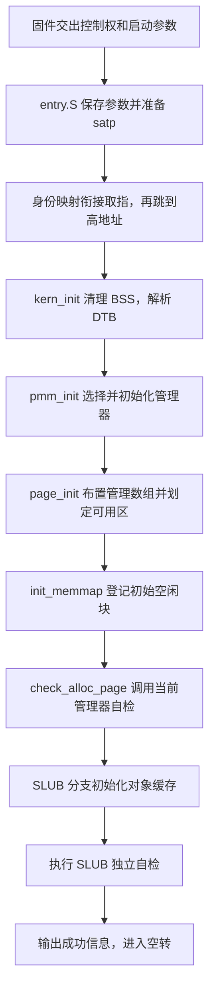

# Lab2 代码 Review：从启动到物理页分配与回收

更新日期：2026-10-22。

本文前十节对应 hews 的 `Dev/Lab2/hews/page-init` 阶段，使用 First Fit 验证页初始化；第十一至十六节讲解组员参考包中的 Best Fit，来源为本地 `Dev/Lab2/hews/setup` 的 `346331b` 快照。第十七节是新分支 `Dev/Lab2/hews/slub` 的对象分配扩展及其发现的 First Fit 尾插修复。Best Fit 尚未随 SLUB 分支接入；模块职责见 [分工](division.md)。

阅读方式是“先看总体流程，再按章节理解概念、代码和实例”。遇到不确定的概念，可以直接用章节号、函数名或代码行提问；后续说明继续补充到本文。

答辩时的开场陈述、模拟问答、速查公式和现场演示另见 [答辩复习文档](defense.md)。

前十六节地址示例取自页初始化阶段及已有调试日志；SLUB 当前构建数值见第十七节。内核大小改变后，页表、`end`、管理数组和空闲区的具体位置可能变化。代码通过符号和内存信息计算位置，不依赖示例中的固定结果。

## 阅读顺序与完整调用关系

| 阅读目标 | 章节 | 先抓住的问题 |
| --- | --- | --- |
| 内核怎样开始运行 | 一～四 | PC、虚实地址、Sv39、索引、`satp` 与身份映射 |
| 可分配物理内存从哪里来 | 五～十 | 页与管理记录、页号、对齐、保留区和初始空闲块 |
| 空闲块怎样组织 | 十一 | 双向循环链表、链表头、`page_link` 与 `le2page()` |
| 申请连续页怎样选块和拆分 | 十二 | 最小足够块、断链、剩余块与计数 |
| 释放的页怎样归还和合并 | 十三 | 按地址插入、连续性、前后合并 |
| 多个模块怎样接在一起 | 十四 | 函数指针、管理器表、当前启用的策略 |
| 测试实际证明了什么 | 十五 | 原始自检、评分、独立位图、运行环境 |
| 怎么把一轮操作串起来 | 十六 | 分配与释放前后的记录、链表和物理区间 |
| 怎样提供任意字节长度对象 | 十七 | SLUB 分层、对象缓存、partial、槽位复用、耗尽与归还 |



对应入口为 [entry.S](../kern/init/entry.S)、[kern_init()](../kern/init/init.c)、[pmm_init()](../kern/mm/pmm.c)。当前实验的普通启动主要运行初始化和自检，随后空转；后面的分配、释放接口供自检和未来内核模块调用。

`entry.S` 先将固件传来的 DTB 地址保存到 `boot_dtb`。`kern_init()` 调用 `dtb_init()` 解析硬件描述，`page_init()` 再通过 `get_memory_base()`、`get_memory_size()` 取得内存范围。这样从启动参数到可分配内存就连起来了。

参考包的对应实现可以直接在 ZIP 内阅读，也可以在本仓库查看本地快照：

```bash
git show 346331b:lab2/kern/mm/best_fit_pmm.c
git show 346331b:lab2/tools/test_best_fit_host.c
```

## 一、先理解启动映射解决什么问题

### 1. CPU 怎样找到下一条指令

CPU 有一个寄存器叫 PC，保存当前要执行的指令地址。执行一条普通指令后，CPU 会继续取得下一条指令；分支和跳转指令则可以改变接下来执行的位置。

本实验中，固件将控制权交给位于物理地址 `0x80200000` 的内核入口。但是链接脚本按高地址安排内核符号：

```ld
BASE_ADDRESS = 0xFFFFFFFFC0200000;
```

代码位置：[kernel.ld](../tools/kernel.ld)。

因此，需要区分两个地址：

| 地址 | 当前含义 |
| --- | --- |
| `0x80200000` | 内核入口在物理内存中的位置 |
| `0xffffffffc0200000` | 内核入口对应的链接虚拟地址 |

启动代码要完成从物理地址取指，到按内核的高位虚拟地址运行的过渡。

### 2. 虚拟地址、物理地址与 MMU

物理地址表示内存中的实际位置。启用地址转换后，程序发出的取指和访存地址先作为虚拟地址，由 CPU 中负责地址转换的硬件 MMU，根据页表转换成物理地址。

例如，我们希望建立下面的对应关系：

```text
虚拟地址 0xffffffffc0200000
                  ↓ 页表规定的转换
物理地址 0x80200000
```

操作系统负责准备页表；硬件在取指和访存时使用页表。页表中保存的是映射规则，代码和数据仍保存在相应的物理内存中。

### 3. 身份映射和高地址映射

身份映射表示虚拟地址与物理地址的数值相同：

```text
虚拟地址 0x80200038 → 物理地址 0x80200038
```

高地址映射让一个数值很高的虚拟地址，对应到实际存放内核的物理位置：

```text
虚拟地址 0xffffffffc0200038 → 物理地址 0x80200038
```

这两种映射可以同时存在。同一份物理内存可以通过多个不同的虚拟地址访问。

当前启动代码需要身份映射衔接启用分页后的几条指令，然后显式跳到高地址继续运行。

## 二、Sv39、页表索引与根页表

### 1. Sv39 是什么

Sv39 是 RISC-V 的一种虚拟内存地址转换方案。本实验运行在 64 位环境中，地址保存在 64 位寄存器里；Sv39 使用下面的 39 位结构进行地址转换：

```text
位号     38       30 29       21 20       12 11          0
         +----------+----------+----------+--------------+
         | VPN[2]   | VPN[1]   | VPN[0]   | 页内偏移     |
         | 9 位     | 9 位     | 9 位     | 12 位        |
         +----------+----------+----------+--------------+
```

普通 4 KiB 页内有 `2^12 = 4096` 个字节，因此需要 12 位表示页内的字节位置。

其余三个 9 位字段用于查询页表。有效 Sv39 地址的第 63～39 位必须与第 38 位相同，这使它同时具有一段低地址范围和一段高地址范围；本实验的高位内核地址符合这一规则。

代码中的位移和索引定义见 [mmu.h](../kern/mm/mmu.h)。

### 2. 索引本身是什么意思，谁使用它

可以把一张页表看成有 512 个元素的数组，每个元素是一个页表项，简称 PTE。

```text
页表[0]
页表[1]
……
页表[511]
```

索引就是访问这个数组时使用的编号。9 位可以表示 `0～511`，所以每个索引字段可以选择 512 项中的一项。

硬件进行地址转换时，从虚拟地址中取出这些字段查询页表。内核编写页表内容时，也要先算清楚一个虚拟地址会使用哪个表项。

每项占 8 字节，因此一张表的大小是：

```text
512 × 8 = 4096 字节 = 4 KiB
```

### 3. 为什么叫三级页表，当前却只有一张表

通常，硬件先使用 VPN[2] 查询根页表，再根据表项指向的下一级页表，用 VPN[1] 和 VPN[0] 继续查询。

但 Sv39 允许提前在上层遇到直接给出映射的叶表项。叶表项表示已经找到映射终点，可以根据它计算物理地址。

本实验的启动根页表直接使用叶表项。根表中的一个叶项覆盖 `2^30` 字节，即 1 GiB。因此当前启动阶段只需要实际放置一张根表，无须创建另外两层表。

代码中的“三级页表”注释应结合这个区别理解：Sv39 支持三级查询，当前启动映射在根表处就结束查询。

### 4. 两个关键地址为什么分别使用索引 2 和 511

根页表索引的计算方式是：

```c
(virtual_address >> 30) & 0x1ff
```

右移 30 位去掉低 30 位，`& 0x1ff` 保留接下来的 9 位。

代入当前启动过程中的地址：

| 虚拟地址 | 根表索引 VPN[2] | 使用场景 |
| --- | ---: | --- |
| `0x80200038` | 2 | 刚启用分页、尚未跳转高地址时的取指 |
| `0xffffffffc0200038` | 511 | 对应的高地址取指 |

索引 2 对应从 `0x80000000` 开始的低位 1 GiB 区间；索引 511 对应从 `0xffffffffc0000000` 开始的高位 1 GiB 区间。

注意，高地址映射区间的起点是 `0xffffffffc0000000`，内核位于其中偏移 `0x200000` 的位置，所以内核链接起点是 `0xffffffffc0200000`。

## 三、对照 entry.S 看页表与 satp

代码位置：[entry.S](../kern/init/entry.S)。

### 1. 根页表的实际内容

当前根页表如下：

```asm
boot_page_table_sv39:
    .zero 8 * 2
    .quad (0x80000 << 10) | 0xcf
    .zero 8 * 508
    .quad (0x80000 << 10) | 0xcf
```

`.zero` 和 `.quad` 是汇编器生成数据时使用的指令，页表数据随后放入内核镜像：

- `.zero 8 * 2`：生成 16 字节的零，填充索引 0、1。
- 第一条 `.quad`：生成一个 8 字节的表项，占据索引 2。
- `.zero 8 * 508`：填充索引 3～510。
- 最后一条 `.quad`：填充索引 511。

总项数仍然是：

```text
2 + 1 + 508 + 1 = 512
```

两个有效表项都映射到从物理地址 `0x80000000` 开始的 1 GiB 范围。

```text
索引 2：   低位虚拟区间 → 物理区间，形成身份映射
索引 511： 高位虚拟区间 → 同一物理区间
```

### 2. `(0x80000 << 10) | 0xcf` 表示什么

`0x80000` 是目标物理基址 `0x80000000` 对应的物理页号：

```text
0x80000000 >> 12 = 0x80000
```

PTE 中的物理页号字段从第 10 位开始，所以需要左移 10 位。后面的 `0xcf` 设置状态和权限位：

| 位 | 含义 | 当前值 |
| --- | --- | ---: |
| V | 表项有效 | 1 |
| R | 允许读 | 1 |
| W | 允许写 | 1 |
| X | 允许执行 | 1 |
| U | 用户态可访问 | 0 |
| G | 全局映射标记 | 0 |
| A | 已访问标记 | 1 |
| D | 已写入标记 | 1 |

设置了读、写、执行权限，这个有效表项就作为叶项使用。它描述的是从哪里开始映射、允许怎样访问。

### 3. satp 是什么

`satp` 是 RISC-V 中控制 S 模式地址转换的寄存器。当前内核通过它告诉硬件：

1. 使用哪一种地址转换模式。
2. 根页表实际放在哪一个物理页。

在 RV64 的 Sv39 模式下，其字段为：

```text
63        60 59              44 43                         0
+-----------+------------------+----------------------------+
| MODE      | ASID             | 根页表物理页号 PPN         |
+-----------+------------------+----------------------------+
```

MODE 取 8 表示 Sv39；ASID 可以用于区分地址空间，当前为零；PPN 指出根页表所在的物理页。

根表的地址必须是物理位置，因为硬件要先找到根表，才能利用它进行虚拟地址转换。

### 4. 代码怎样计算 satp 的值

```asm
lui     t0, %hi(boot_page_table_sv39)
li      t1, 0xffffffffc0000000 - 0x80000000
sub     t0, t0, t1
srli    t0, t0, 12

li      t1, 8 << 60
or      t0, t0, t1
csrw    satp, t0
```

`t0`、`t1` 是用于中间计算的通用寄存器；`csrw` 将计算结果写入指定的控制寄存器。

当前构建中，根页表按 4 KiB 对齐，地址为：

```text
根页表虚拟地址 = 0xffffffffc0205000
虚实地址偏移   = 0xffffffff40000000
根页表物理地址 = 0x80205000
根页表物理页号 = 0x80205000 >> 12 = 0x80205
```

代码里的减法取得物理地址，右移取得物理页号，再加入模式字段：

```text
satp = (8 << 60) | 0x80205
     = 0x8000000000080205
```

这里的两个物理页号用途不同：

| 页号 | 出现位置 | 用途 |
| --- | --- | --- |
| `0x80205` | `satp` | 告诉硬件根页表存放在哪里 |
| `0x80000` | 根表的两个叶项 | 告诉硬件映射目标物理区间从哪里开始 |

## 四、为什么必须补身份映射

### 1. 实际观察到的故障

原始根表只设置了索引 511 的高地址映射。已有 [GDB 调试日志](logs/boot-debug-gdb.log)记录：

```text
pc   = 0x80200034
satp = 0

0x80200034: csrw satp,t0
0x80200038: sfence.vma
```

执行写入 `satp` 的指令后：

```text
pc   = 0x80200038
satp = 0x8000000000080205
Cannot access memory at address 0x80200038
```

### 2. 为什么下一条指令明明在那里，却取不到

关键在于：启用 Sv39 后，PC 中原来的低地址数值仍然保留，但接下来的取指开始需要地址转换。

写入 `satp` 之前，入口正在物理位置 `0x80200034` 执行。写入之后，下一条指令地址仍然是数值 `0x80200038`，不会因为打开分页就自动变成 `0xffffffffc0200038`。

硬件按照这个低位虚拟地址查询根表，算出的索引是 2。然而原始表中索引 2 为零，表示无效，所以新页表没有为这次取指提供映射。

指令的字节仍然存放在物理内存中；当前地址转换规则无法让这次虚拟地址访问到达它。这与代码字节是否已经装入内存是两个问题。

### 3. 身份映射怎样让启动继续

补上索引 2 后：

```text
PC 数值 0x80200038
        ↓ 根表索引 2
物理地址 0x80200038
```

入口就可以继续执行：

```asm
sfence.vma
lui sp, %hi(bootstacktop)
lui t0, %hi(kern_init)
addi t0, t0, %lo(kern_init)
jr t0
```

`sfence.vma` 用于同步页表相关的地址转换状态，避免继续沿用不适用的缓存翻译。`sp` 是栈指针，后面的指令把它设置到内核的高位虚拟栈地址。

`lui` 和 `addi` 组合构造 `kern_init` 的高位虚拟地址，`jr t0` 显式跳转过去。此后 PC 使用高地址，查询根表索引 511，再映射到存放内核代码的物理位置。

因此完整过渡为：

```text
按低位地址执行启动入口
    → 写入 satp，启用 Sv39
    → 依靠身份映射继续执行几条指令
    → 显式跳转到 kern_init 的高地址
    → 使用高地址映射运行 C 代码
```

当前实现没有在跳转后删除索引 2；身份映射仍保留在启动根表中。

## 五、page_init() 要建立什么管理信息

代码位置：[pmm.c](../kern/mm/pmm.c)、[memlayout.h](../kern/mm/memlayout.h)。

### 1. 地址能访问之后，还需要分配与回收

前面建立了 CPU 可以使用的映射。接下来内核需要知道哪些物理内存已经占用、哪些可以分配，以及分配和回收时要更新什么记录。

物理内存分配器按 4 KiB 管理内存：

```c
#define PGSIZE 4096
```

例如：

| 物理页 | 覆盖的物理地址 |
| --- | --- |
| 第一个页 | `[0x80000000, 0x80001000)` |
| 第二个页 | `[0x80001000, 0x80002000)` |
| 第三个页 | `[0x80002000, 0x80003000)` |

区间 `[begin, end)` 包含起点、不包含终点。第一行最后一个字节是 `0x80000fff`，下一个字节开始进入第二页。

启动叶项的 1 GiB 是硬件映射覆盖范围，这里的 4 KiB 是分配器的管理单位。同一段内存可以先通过一个大范围映射访问，再按 4 KiB 分配。

### 2. 物理页与 struct Page

```c
struct Page {
    int ref;
    uint64_t flags;
    unsigned int property;
    list_entry_t page_link;
};
```

每一个 `struct Page` 是描述一个物理页的管理记录。物理页本身有 4096 字节，而当前 RISC-V64 编译环境中，一条管理记录占 40 字节，包含字段之间为对齐保留的空隙。

| 字段 | 用途 |
| --- | --- |
| `ref` | 引用计数，供内核记录页的引用情况 |
| `flags` | 状态标记，例如是否保留、是否为空闲块起始页 |
| `property` | 在空闲块起始页处，记录整个块的页数 |
| `page_link` | 双向链表节点，用于连接空闲块 |

全局变量保存管理数组的起始指针：

```c
struct Page *pages;
```

它与物理页的对应关系为：

```text
pages[0] 描述物理页 [0x80000000, 0x80001000)
pages[1] 描述物理页 [0x80001000, 0x80002000)
pages[2] 描述物理页 [0x80002000, 0x80003000)
……
```

数组索引 `i` 表示从这段物理内存起点开始数的第几个页：

```text
pages[i] 描述的物理页起点 = DRAM_BASE + i × 4096
```

管理记录本身也占内存。它存放在哪里，与它描述的物理页在哪里，需要分别理解。

## 六、读取内存范围与计算页数

### 1. 从 DTB 取得范围

`kern_init()` 已经先调用 `dtb_init()`，然后才调用 `pmm_init()`。DTB 是启动时交给内核的设备树数据，其中包含内存起点和大小。

```c
extern char end[];
uintptr_t mem_base = get_memory_base();
uintptr_t mem_size = get_memory_size();
```

这里的两个函数读取已经解析出的内存信息。`uintptr_t` 是可以容纳地址数值的整数类型，方便进行加减、移位和对齐计算。

默认启动配置为：

```text
mem_base = 0x80000000
mem_size = 0x08000000 = 128 MiB
```

接着执行：

```c
va_pa_offset = PHYSICAL_MEMORY_OFFSET;
assert(mem_base == DRAM_BASE);
assert(mem_size > 0 && mem_size <= (1UL << SV39_VPN2SHIFT));
uintptr_t mem_end = mem_base + mem_size;
```

`va_pa_offset` 保存前面使用过的虚实地址偏移。两个断言检查内存起点符合当前固定布局、内存大小为正且没有超出启动映射覆盖的 1 GiB。

`assert` 的条件失败时会报告错误并停止内核，防止继续使用不符合前提的布局。

```text
mem_end = 0x80000000 + 0x08000000 = 0x88000000
物理内存区间 = [0x80000000, 0x88000000)
```

### 2. nbase、npage 与 page_count

物理页号从物理地址零开始编号。用物理地址除以 4096，就能算出它所在的物理页号。4096 等于 `2^12`，所以代码使用右移：

```c
#define PPN(la) (((uintptr_t)(la)) >> PGSHIFT)
```

相关初始化为：

```c
const size_t nbase = DRAM_BASE / PGSIZE;
```

```c
npage = PPN(mem_end);
assert(npage > nbase);
size_t page_count = npage - nbase;
```

代入默认配置：

| 变量 | 当前值 | 含义 |
| --- | ---: | --- |
| `nbase` | `0x80000` | 本段物理内存的起始物理页号 |
| `npage` | `0x88000` | 结束边界对应的物理页号，作为有效页号上界 |
| `page_count` | `0x8000 = 32768` | 本段物理内存中完整页的数量 |

```text
page_count = 0x88000 - 0x80000 = 32768
128 MiB / 4 KiB = 32768 页
```

骨架中 `npage` 的注释不够准确。结合 `pa2page()` 等函数理解，其实际用途是页号上界；本段内存的页数是 `npage - nbase`。

## 七、把管理数组放在内核之后

### 1. end 是链接器提供的边界

`extern char end[]` 引用链接器提供的符号。链接脚本将它放在内核各部分，包括 `.bss` 之后：

```ld
PROVIDE(end = .);
```

这里使用符号的地址来表示内核结束位置。这条 `extern` 声明没有新建一个缓冲区，也无须调用 `malloc()`。

当前构建中：

```text
end 的虚拟地址 = 0xffffffffc0206078
```

### 2. 页对齐与指针转换

```c
pages = (struct Page *)ROUNDUP((uintptr_t)end, PGSIZE);
```

按执行含义拆开：

1. `(uintptr_t)end`：把边界地址作为整数进行计算。
2. `ROUNDUP(..., PGSIZE)`：向上取到最近的 4096 的倍数；已经对齐时保持原值。
3. `(struct Page *)`：把结果作为管理数组的起始指针。

```text
内核结束位置：0xffffffffc0206078
向上按页对齐：0xffffffffc0207000
pages        = 0xffffffffc0207000
```

这里选定数组的位置；后面的循环才逐项写入管理记录。

### 3. PADDR 如何取得数组的物理位置

```c
uintptr_t pages_pa = PADDR(pages);
```

[pmm.h](../kern/mm/pmm.h) 中 `PADDR` 的核心计算是：

```text
物理地址 = 内核虚拟地址 - va_pa_offset
```

当前结果为：

```text
管理数组虚拟起点：0xffffffffc0207000
管理数组物理起点：0x80207000
```

`PADDR` 根据已知的线性映射关系做数值计算。CPU 实际通过 `pages[i]` 读写时，仍由页表完成地址转换。

现在可以明确区分两个位置：

```text
pages[0] 这条管理记录，自己存放在物理地址 0x80207000
pages[0] 描述的物理页，从物理地址 0x80000000 开始
```

## 八、计算管理数组末尾与空闲区

### 1. 管理数组需要多少空间

```text
32768 条记录 × 40 字节/条
    = 1310720 字节
    = 0x140000 字节
    = 320 个 4 KiB 页
```

所以数组占用的物理区间是：

```text
[0x80207000, 0x80207000 + 0x140000)
= [0x80207000, 0x80347000)
```

写入记录之前，代码先检查数组起点和容量：

```c
assert(pages_pa >= mem_base && pages_pa < mem_end);
assert(page_count <= (mem_end - pages_pa) / sizeof(struct Page));
```

第二条断言右侧表示：从数组起点到物理内存末尾，最多还能放下多少条记录。先使用除法检查容量，再计算数组总大小，可以避免在检查之前就依赖可能溢出的乘法结果。

### 2. 空闲区起点向上对齐，终点向下对齐

```c
uintptr_t free_begin =
    ROUNDUP(pages_pa + page_count * sizeof(struct Page), PGSIZE);
uintptr_t free_end = ROUNDDOWN(mem_end, PGSIZE);
assert(free_begin < free_end);
```

起点向上对齐，避开数组可能只占用一部分的最后一页；终点向下对齐，保证交给分配器的都是完整存在于物理内存中的页。

当前结果恰好都已对齐：

```text
free_begin = 0x80347000
free_end   = 0x88000000
```

### 3. 当前完整物理布局

| 物理区间 | 用途 | 页数 |
| --- | --- | ---: |
| `[0x80000000, 0x80200000)` | 内核之前的预留区域，包含固件 | 512 |
| `[0x80200000, 0x80207000)` | 内核及页边界补齐空间 | 7 |
| `[0x80207000, 0x80347000)` | `struct Page` 管理数组 | 320 |
| `[0x80347000, 0x88000000)` | 可以分配的物理内存 | 31929 |

```text
保留页数 = 512 + 7 + 320 = 839
空闲页数 = 32768 - 839 = 31929
```

管理数组占用的物理页也必须保留，否则分配器可能把管理记录所在的内存交出去，导致记录被其他数据覆盖。

## 九、先初始化所有记录，再开放空闲区

### 1. 所有物理页最初都标记为保留

```c
for (size_t i = 0; i < page_count; i++) {
    struct Page *page = &pages[i];
    page->flags = 0;
    SetPageReserved(page);
    page->property = 0;
    set_page_ref(page, 0);
    list_init(&page->page_link);
}
```

`&pages[i]` 取得第 i 条记录的地址，`page->字段` 修改这条记录对应的字段。

| 代码 | 初始化的含义 |
| --- | --- |
| `page->flags = 0` | 清空此前的状态位 |
| `SetPageReserved(page)` | 设置保留标记，暂时禁止参与分配 |
| `page->property = 0` | 当前尚未登记为空闲块起始页 |
| `set_page_ref(page, 0)` | 引用计数初始为零 |
| `list_init(&page->page_link)` | 初始化链表节点，使前后指针都指向自己 |

保留标记的定义是：

```c
#define PG_reserved 0
#define SetPageReserved(page) ((page)->flags |= (1UL << PG_reserved))
```

`PG_reserved = 0` 表示使用第 0 位。`1 << 0` 等于 1，因此从 `flags = 0` 开始设置后，`flags` 的值为 1。

`list_init()` 让节点处于独立的初始状态，此时尚未把所有物理页分别加入全局空闲链表。

循环完成后，所有物理页都有对应记录，并且全部暂时保留。随后只对明确可用的范围清除保留标记。

### 2. pa2page 找到首个空闲页的记录

```c
init_memmap(pa2page(free_begin), (free_end - free_begin) / PGSIZE);
```

第二个参数是可用页数：

```text
(0x88000000 - 0x80347000) / 4096 = 31929
```

第一个参数把物理地址转换成对应的管理记录。`pa2page()` 的主要计算为：

```c
return &pages[PPN(pa) - nbase];
```

代入起点：

```text
PPN(0x80347000) = 0x80347
0x80347 - 0x80000 = 0x347 = 839
pa2page(free_begin) = &pages[839]
```

因此：

```text
pages[0]   ～ pages[838]   对应保留页
pages[839] ～ pages[32767] 对应可分配页
```

### 3. 指针加一与物理地址增加一页

```c
struct Page *base = &pages[839];
```

`base + 1` 移动到下一条管理记录，指针地址增加 `sizeof(struct Page)`，当前为 40 字节。

但下一条记录所描述的物理页，相对于上一页增加 4096 字节：

```text
管理记录之间的间隔：40 字节
物理页之间的间隔：4096 字节
```

因此分配器可以用 `base + n` 表示向后数 n 个物理页对应的记录。对于有效记录，反向转换 `page2pa()` 使用：

```text
物理页号 = (page - pages) + nbase
物理地址 = 物理页号 << 12
```

## 十、怎样把空闲区交给当前的 First Fit

### 1. 管理器在 page_init() 之前就已经选好

`pmm_init()` 的顺序为：

```c
init_pmm_manager();
page_init();
check_alloc_page();
```

`init_pmm_manager()` 选择当前管理器：

```c
pmm_manager = &default_pmm_manager;
pmm_manager->init();
```

管理器初始化时先建立空链表，并把空闲页数设为零：

```c
list_init(&free_list);
nr_free = 0;
```

随后，`page_init()` 调用的包装函数把参数交给已选中的管理器：

```c
static void init_memmap(struct Page *base, size_t n) {
    pmm_manager->init_memmap(base, n);
}
```

这里的 `init_memmap` 字段保存函数指针，可以理解为预先选定的函数入口。当前实际调用 [default_pmm.c](../kern/mm/default_pmm.c) 中的 `default_init_memmap()`。组员完成 Best Fit 并切换管理器后，同一接口才会转交给 Best Fit。

### 2. 清除可用范围的保留标记

```c
static void
default_init_memmap(struct Page *base, size_t n) {
    assert(n > 0);
    struct Page *p = base;
    for (; p != base + n; p ++) {
        assert(PageReserved(p));
        p->flags = p->property = 0;
        set_page_ref(p, 0);
    }
    /* 后续代码登记块首、页数，并按地址插入空闲链表。 */
}
```

当前传入 `base = &pages[839]`、`n = 31929`。循环只处理可用范围，先确认它们都经过了保留初始化，然后清除状态位和计数。

### 3. 把整段连续内存登记为一个空闲块

`default_init_memmap()` 在循环后直接设置：

```c
base->property = n;
SetPageProperty(base);
nr_free += n;
```

然后把起始页的链表节点加入空闲链表。当前链表原本为空，所以第一次登记得到一个包含 31929 页的空闲块。

一个块可以包含很多页，链表通过块起始页代表整块；其他页由块首记录的长度覆盖，无须逐页加入空闲链表。

最终状态为：

| 记录 | 保留标记 | 空闲块起始标记 | `property` |
| --- | ---: | ---: | ---: |
| `pages[0..838]` | 有 | 无 | 0 |
| `pages[839]` | 无 | 有 | 31929 |
| `pages[840..32767]` | 无 | 无 | 0 |

`PG_property` 使用第 1 位，所以这里块首的 `flags` 为 2，空闲块内部页为 0，保留页为 1。内部页仍然空闲，只是没有单独设置块首标记；不能仅凭某页没有块首标记，就判断它已被分配。

### 4. 与实际输出对应

[初始化阶段启动日志](logs/page-init-qemu.log)中的输出是：

```text
physical memory: [0x0000000080000000, 0x0000000088000000)
page descriptors: 32768, npage: 0x88000
free physical memory: [0x0000000080347000, 0x0000000088000000), 31929 pages
check_alloc_page() succeeded!
```

前三行对应前面的内存范围、管理记录数量和空闲页计算。随后 `check_alloc_page()` 调用管理器的检查函数，成功后才打印最后一行。

## 十一、Best Fit 的基础：空闲块与双向循环链表

以下分析使用完整参考版本。初始化时只有一个大空闲块，运行中的分配与释放可以让内存形成多个由已占用页分隔的空闲块。

### 1. 申请 n 页的含义

```c
struct Page *alloc_pages(size_t n) {
    return pmm_manager->alloc_pages(n);
}
```

`alloc_pages(2)` 表示申请两个连续物理页，共 `2 × 4096 = 8192` 字节。成功时返回首个物理页对应的管理记录；失败时返回 `NULL`。

这里的连续是物理地址连续。例如两段相隔很远的单页，虽然合计有两页，也不能组成一次连续两页的申请。

### 2. 为什么用链表

页数组 `pages[]` 按物理页编号保存全部管理记录；空闲链表从这些记录中选出空闲块的起始页，连接起来，方便只遍历空闲块。

链表节点的定义见 [list.h](../libs/list.h)：

```c
struct list_entry {
    struct list_entry *prev, *next;
};
typedef struct list_entry list_entry_t;
```

`prev` 保存前一个节点的地址，`next` 保存后一个节点的地址。节点通过地址相互连接，所以遍历时跟着指针走，无须依次检查 `pages[]` 的所有元素。

`struct Page` 内部放了一个 `page_link` 成员，这个成员就是它参与链表时使用的节点。

### 3. 链表头和普通节点有什么区别

管理器使用：

```c
static free_area_t free_area;
#define free_list (free_area.free_list)
#define nr_free (free_area.nr_free)
```

`free_list` 是一个实际的链表头对象，`&free_list` 是它的地址。这个头只负责标记链表起点和终点，本身不代表任何物理页。

下面假设有 A、B、C 三个空闲块：


这是循环链表：沿 `next` 走到最后一个节点后，会重新回到头。空表时，头的前后指针都指向自己。

链表顺序代表空闲块的地址顺序。A、B 在链表中相邻，只表示它们之间没有别的空闲块；中间仍可能隔着已经分配的物理页。

### 4. 几个链表函数逐个对应什么动作

| 调用 | 动作 |
| --- | --- |
| `list_init(node)` | 让节点的前后指针都指向自己 |
| `list_next(node)` | 返回 `node->next` |
| `list_prev(node)` | 返回 `node->prev` |
| `list_del(node)` | 让它的左右邻居直接连接，将它移出链表 |
| `list_add(prev, node)` | 将 `node` 插在 `prev` 后面 |
| `list_add_before(next, node)` | 将 `node` 插在 `next` 前面 |

`list_add()` 的含义是“插在指定节点之后”，并非固定插到表尾。

`list_del()` 修改的是指针关系。管理记录仍然保存在 `pages[]` 中，它描述的物理内存也仍然存在。该函数没有清空被移出节点自身的前后指针，不能用残留指针判断它是否仍在空闲链表中。

### 5. le2page() 怎样从节点找到 Page

遍历得到的 `le` 是 `list_entry_t *`，指向 `Page` 内部的 `page_link`；但块长度 `property` 位于整个 `Page` 结构中，因此要找到所属结构的起点：

```c
struct Page *page = le2page(le, page_link);
```

相关宏见 [memlayout.h](../kern/mm/memlayout.h) 和 [defs.h](../libs/defs.h)：

```c
#define le2page(le, member) to_struct((le), struct Page, member)
#define to_struct(ptr, type, member) \
    ((type *)((char *)(ptr) - offsetof(type, member)))
```

`offsetof` 表示从结构体起点到指定成员之间相隔多少字节。在当前结构布局中，`page_link` 从第 24 字节开始：

```text
Page 起点  ──向后 24 字节──> page_link
Page 起点  <──向前 24 字节── le
```

宏将指针转为 `char *`，按字节减去偏移，再转回 `struct Page *`。结构体本身没有搬动，只是计算出了起始地址。

链表头没有所属的 `Page`，所以遍历必须先确认 `le != &free_list`，再调用 `le2page()`。

## 十二、Best Fit 怎样选择、分配和拆分

源码：参考快照 `kern/mm/best_fit_pmm.c` 的 `best_fit_alloc_pages()`。

### 1. 使用同一个例子贯穿整个过程

假设内存运行一段时间后，有以下三个空闲块，其余相关页已经占用：

| 块 | 起始管理记录 | 长度 | 物理区间 |
| --- | --- | ---: | --- |
| A | `pages[1000]` | 8 页 | `[0x803e8000, 0x803f0000)` |
| B | `pages[2000]` | 3 页 | `[0x807d0000, 0x807d3000)` |
| C | `pages[3000]` | 5 页 | `[0x80bb8000, 0x80bbd000)` |

链表按地址排列为 A → B → C，空闲总数为 `8 + 3 + 5 = 16` 页。申请 2 页时，Best Fit 会选择 B，因为它是所有足够大块中最小的。

### 2. 先检查请求与总空闲页数

```c
assert(n > 0);
if (n > nr_free) {
    return NULL;
}
```

这里约定申请页数必须大于零，违反约定会触发断言。总空闲数不足时可以立即返回失败。

总空闲数足够仍可能找不到连续块。例如上述状态申请 9 页，虽然总共空闲 16 页，但最大块只有 8 页，最终仍会失败。

### 3. best 与 le 分别保存什么

```c
struct Page *best = NULL;
list_entry_t *le = &free_list;
while ((le = list_next(le)) != &free_list) {
    struct Page *page = le2page(le, page_link);
    /* 比较候选块 */
}
```

- `best` 保存目前找到的最佳块的起始记录；最初为 `NULL`，表示尚未找到。
- `le` 保存当前链表节点的位置；最初站在链表头。
- `page` 是把当前节点换算成所属 `Page` 后得到的指针。

`while` 的条件先执行 `le = list_next(le)`，再判断是否回到头。因此第一轮访问第一个真实空闲块，回到头时结束，空表则一次都不进入循环。

查找过程中，`best = page` 只是改变局部指针，还没有从空闲链表中取出任何块。

### 4. 两个条件怎样选出最小足够块

```c
if (page->property >= n &&
    (best == NULL || page->property < best->property)) {
    best = page;
    if (page->property == n) {
        break;
    }
}
```

`page->property >= n` 检查装得下。后面的条件表示：此前没有候选，或者当前块比此前候选更小。

`&&` 要求两边都成立；`||` 表示至少一边成立。这里还利用了从左往右的短路求值：`best == NULL` 成立时，不再读取 `best->property`，避免通过空指针访问字段。

申请 2 页时：

| 访问块 | 是否足够 | 与现有候选比较 | best |
| --- | --- | --- | --- |
| A：8 页 | 是 | 之前没有候选 | A |
| B：3 页 | 是 | 3 小于 8 | B |
| C：5 页 | 是 | 5 不小于 3 | B |

比较使用严格小于，因此同样大小的块保留先遇到的一个。链表按地址递增，所以等大时选择低地址块。

如果遇到恰好 n 页的块，已经不可能再找到更小且足够的块，所以可以直接 `break`。

### 5. 为什么查找后还要检查 NULL

```c
if (best == NULL) {
    return NULL;
}
```

这个分支处理总空闲页数够、但没有单个连续块够大的情况。失败之前没有改变链表和统计，因此申请失败不会消耗空闲页。

### 6. 保存位置并把选中块移出链表

```c
list_entry_t *prev = list_prev(&best->page_link);
list_del(&best->page_link);
```

`&best->page_link` 取得选中块首的链表节点地址。代码先保存它前面的节点，以便稍后将剩余块放回相应位置。

选中 B 时，`prev` 指向 A 的节点。删除 B 后，A 和 C 直接相连；B 的管理记录仍在数组里，仍可以通过 `best` 修改。

### 7. 较大的块怎样拆分

```c
if (best->property > n) {
    struct Page *rest = best + n;
    rest->property = best->property - n;
    SetPageProperty(rest);
    list_add(prev, &rest->page_link);
}
```

B 有 3 页，申请 2 页时：

```text
原来的 B：pages[2000]、pages[2001]、pages[2002]
分配部分：pages[2000]、pages[2001]
剩余部分：pages[2002]
```

`best + n` 按 `Page` 元素移动 n 个位置，因此得到 `&pages[2002]`。新块首的长度设为 `3 - 2 = 1`，再设置块首标记。

`list_add(prev, ...)` 把剩余块放在 A 后面，得到 A → 剩余块 → C。这既恢复了空闲块记录，也保持地址顺序。

恰好 n 页时，没有剩余块，这个分支不会执行。

### 8. 清理已分配块首并扣除页数

```c
ClearPageProperty(best);
best->property = 0;
nr_free -= n;
return best;
```

选中块的前半部分已经交给调用者，原块首不能继续标为空闲块首，因此清掉标记和长度。

原来的总空闲数已经包含 B 的全部 3 页，拆分后只减去实际分走的 2 页即可：

```text
nr_free = 16 - 2 = 14
链表中的块长度之和 = 8 + 1 + 5 = 14
```

不能再把剩余块的 1 页加进计数，否则会重复计算。

### 9. 返回的指针怎样理解

当前返回 `&pages[2000]`，表示分配结果的第一个物理页对应的管理记录。

用 `page2pa(best)` 得到被分配物理页的起始地址 `0x807d0000`。本次两页覆盖：

```text
[0x807d0000, 0x807d2000)
```

`PADDR(best)` 计算的是管理记录自身所在的物理位置，`page2pa(best)` 才计算这条记录所描述的物理页地址，这两个转换有不同用途。

这个分配函数更新的是管理记录和链表；它没有清空所分配物理页内的全部数据，也没有建立新的虚实映射。`ref` 也不会在这里自动增加，引用计数由相应的使用层管理。

### 10. 策略与代价

First Fit 遇到第一个足够大的块就选；Best Fit 通常需要检查所有候选，选最小足够块。若有 k 个空闲块，本实现一次申请最坏需要遍历 k 个块，时间随 k 增长。

Best Fit 减小的是当前选择的剩余空间，不能保证所有未来请求中的碎片都更少。精确匹配可以提前结束，但最坏仍需遍历整张空闲链表。

## 十三、空闲区登记、释放与相邻块合并

### 1. 为什么要把相邻空闲块合并

假设两个空闲块在物理上连续，一个 2 页，一个 3 页。如果一直把它们记成两个独立块，申请 5 页时就可能被判断为没有足够大的块。

合并是把管理记录整理成一个 5 页块。物理页原本就相邻，代码只需调整块长、标记和链表，无须搬运其中的数据。

参考版本把登记与合并集中放在 `best_fit_insert_block(base, n)` 中。初始空闲区登记和后续释放都调用它。

### 2. init_memmap() 负责接收初始可用区

```c
static void
best_fit_init_memmap(struct Page *base, size_t n) {
    assert(n > 0);
    for (struct Page *page = base; page != base + n; page++) {
        assert(PageReserved(page));
        page->flags = 0;
        page->property = 0;
        set_page_ref(page, 0);
    }
    best_fit_insert_block(base, n);
}
```

`page_init()` 已先把全部页标为保留，然后将真正可用的区间交给这个函数。循环确认并清理对应记录，随后插入一个空闲块。

`base + n` 指向待处理范围之后的第一条记录，因此循环处理的是 `[base, base + n)`，恰好 n 页。

### 3. free_pages() 先清理释放范围

```c
static void
best_fit_free_pages(struct Page *base, size_t n) {
    assert(n > 0);
    for (struct Page *page = base; page != base + n; page++) {
        assert(!PageReserved(page) && !PageProperty(page));
        page->flags = 0;
        page->property = 0;
        set_page_ref(page, 0);
    }
    best_fit_insert_block(base, n);
}
```

这里要求调用者归还自己持有的合法物理页范围。循环检查它们没有保留标记或空闲块首标记，清理状态、长度和引用计数，再交给共用插入函数。

分配时把 `best->property` 清零，因此释放长度 n 需要由调用者提供。例如申请两页后，要用 `free_pages(result, 2)` 归还这段范围。

这些断言只检查部分状态。空闲块内部页也可能没有块首标记，因此不能声称它能识别任意重复释放、重叠释放或错误长度；调用者必须遵守接口约定。

### 4. 先登记新块并增加一次计数

`best_fit_insert_block()` 开头执行：

```c
base->property = n;
SetPageProperty(base);
nr_free += n;
```

这表示新增加了一段 n 页的空闲区。合并前后总空闲页数不变，所以整个插入过程只在这里增加一次计数。

### 5. 按地址找到插入位置

```c
list_entry_t *next = list_next(&free_list);
while (next != &free_list && le2page(next, page_link) < base) {
    next = list_next(next);
}
list_add_before(next, &base->page_link);
```

从第一个空闲块开始，跳过所有起点在 `base` 之前的块。循环停止时，`next` 是第一个地址不小于 `base` 的块，或者已经回到链表头。

各块的 `Page *` 都来自同一个 `pages[]` 数组，比较它们的先后关系就对应物理页编号顺序。

把新块插在 `next` 前面，便保持地址排序。如果 `next` 是链表头，就是插在表尾；如果原来为空表，就是插入第一个块。

`&&` 的短路求值同样重要：`next` 是头时，不会对它执行 `le2page()`。

### 6. 怎样与前一个块合并

```c
list_entry_t *prev = list_prev(&base->page_link);
if (prev != &free_list) {
    struct Page *page = le2page(prev, page_link);
    if (page + page->property == base) {
        page->property += base->property;
        ClearPageProperty(base);
        base->property = 0;
        list_del(&base->page_link);
        base = page;
    }
}
```

关键条件：

```text
前块起点 + 前块页数 == 新块起点
```

前块起点是 `page`，向后数 `page->property` 条记录，恰好到新块起点，就说明物理上连续。

合并时，前块起点保持不变，长度增加；原新块首变成合并块内部页，需要清除块首标记和长度，并从链表移除。

最后的 `base = page` 更新的是局部指针，让接下来检查后块时，使用合并后的真正起点。否则后续连续性计算会使用错误的块首。

### 7. 怎样与后一个块合并

```c
next = list_next(&base->page_link);
if (next != &free_list) {
    struct Page *page = le2page(next, page_link);
    if (base + base->property == page) {
        base->property += page->property;
        ClearPageProperty(page);
        page->property = 0;
        list_del(&page->page_link);
    }
}
```

这里先重新读取当前块的后继，因为前一步可能已经把 `base` 更新成前块。

条件表示“当前块结束边界等于后块起点”。成立时，把后块长度并入当前块，再清除后块的块首状态和链表节点。

### 8. 四种位置关系

| 新释放块与邻居的关系 | 处理结果 |
| --- | --- |
| 两侧都不连续 | 单独保留新块 |
| 只与前块连续 | 新块并入前块 |
| 只与后块连续 | 后块并入新块 |
| 与两侧都连续 | 先并入前块，再把后块并入合并结果 |

例如另设一个局部状态：

```text
前块：[1000, 1002)，2 页
新释放：[1002, 1005)，3 页
后块：[1005, 1009)，4 页
```

先检查 `1000 + 2 == 1002`，合并成从 1000 开始的 5 页块；然后检查 `1000 + 5 == 1005`，再合成 9 页块。

原先空闲 `2 + 4 = 6` 页，释放增加 3 页后为 9 页。两个合并步骤均不再增加 `nr_free`。

### 9. 为什么只需检查直接邻居

插入前的链表已经满足地址排序且相邻空闲区已合并。新块只有可能与它左右紧邻的空闲块连续；更远的块之间还隔着其他区域。

因此，插入后检查前后邻居即可恢复不变量。这个结论依赖输入区间合法、不重叠，以及原链表本身状态正确。

这一共用函数也让乱序到达的初始可用区可以合并：先登记后半段、再登记前半段时，第二次插入会与后邻居连接。独立主机测试专门检查了这个场景。

## 十四、管理器表怎样把接口接起来

### 1. pmm_manager 是一张函数入口表

结构定义见 [pmm.h](../kern/mm/pmm.h)。其中包含函数指针，例如：

```c
struct Page *(*alloc_pages)(size_t n);
void (*free_pages)(struct Page *base, size_t n);
```

它们表示“这里存放一个函数入口，这个函数接收哪些参数、返回什么类型”。

参考实现末尾的表将各入口绑定到具体函数：

```c
const struct pmm_manager best_fit_pmm_manager = {
    .name = "best_fit_pmm_manager",
    .init = best_fit_init,
    .init_memmap = best_fit_init_memmap,
    .alloc_pages = best_fit_alloc_pages,
    .free_pages = best_fit_free_pages,
    .nr_free_pages = best_fit_nr_free_pages,
    .check = best_fit_check,
};
```

这里写函数名，是保存函数入口；真正执行调用时才带上参数括号。

### 2. 一次申请怎样到达实际算法

```text
调用者：alloc_pages(2)
    → pmm.c 包装函数
    → pmm_manager->alloc_pages(2)
    → 当前选定的实际分配函数
```

选择 Best Fit 时，实际入口是 `best_fit_alloc_pages()`；当前个人初始化分支选择 First Fit，对应 `default_alloc_pages()`。

`alloc_page()` 只是 `alloc_pages(1)` 的宏，`free_page(page)` 只是 `free_pages(page, 1)` 的宏。

### 3. 为什么先选管理器，再初始化页

调用顺序为：

```text
选择管理器
    → 管理器 init() 建立空链表、计数归零
    → page_init() 计算可用区
    → 选中管理器的 init_memmap() 登记可用页
    → 选中管理器的 check() 自检
```

First Fit 和 Best Fit 各自在自己的 C 文件中定义 `static free_area_t free_area`，是两套分别保存状态的对象。文件内的 `static` 使这些同名对象具有各自的作用范围。

因此不能先把页登记到 First Fit，再只换一个指针就指望 Best Fit 拥有同一张空闲链表。管理器的选择应在上述初始化流程开始之前确定。

### 4. 查询函数为什么只有一行

```c
static size_t
best_fit_nr_free_pages(void) {
    return nr_free;
}
```

计数已经在登记、分配和释放时维护，查询直接返回即可。这个设计把正确性要求放在状态更新上：每次操作结束后，`nr_free` 都应等于链表中所有块的页数之和。

## 十五、测试的层次与实际覆盖

### 1. 普通启动自检

`pmm_init()` 调用 `check_alloc_page()`，后者调用当前管理器的 `check()`，成功返回后打印：

```text
check_alloc_page() succeeded!
```

因此必须同时看 `memory management: ...`，才能知道具体运行了哪个管理器的检查。当前个人分支的成功信息对应 First Fit；完整参考版本才对应 Best Fit。

普通 `make` 负责构建，执行到这些检查需要启动内核。

### 2. basic_check() 检查基础接口

参考文件中的 `basic_check()` 会申请几个单页，确认得到不同记录、引用计数初值和地址上界等；然后暂时隔离原空闲链表，用这几个页检查空表申请、释放、再次申请和计数恢复。

测试结束时恢复原链表和原计数，并归还取出的页。这类测试中的 `free_list_store` 和 `nr_free_store` 是临时保存状态，以便构造小而可控的场景。

这些函数属于原框架，应保持原文。

### 3. best_fit_check() 的关键选择场景

它先申请 5 页，再暂时隔离其余空闲内存。用 `*` 表示占用、`-` 表示空闲，构造：

```text
位置：0 1 2 3 4
状态：* - - * -
```

此时空闲块有位置 1 开始的两页块，以及位置 4 的单页块。

申请 1 页时，Best Fit 应选择位置 4 的单页块，保留两页连续块。原检查通过 `assert(p0 + 4 == p1)` 确认这一点，然后继续检查两页申请、整块恢复和计数。

这个场景能区分“遇到第一个足够块就选”的策略与这里要求的 Best Fit。

### 4. make test 的 6 / 6 从哪里来

[Makefile](../Makefile) 在目标是 `test` 时加入 `ucore_test` 编译宏，原检查中的条件编译代码才输出各阶段分数。

因此执行 `make test` 前需要 `make clean`：该 Makefile 不会仅因宏变化就自动重编译所有已有对象。

这里的六阶段计分属于 `best_fit_check()`。当前 First Fit 的 `default_check()` 没有这些计分输出；SLUB 分支的 `make test` 仍能完成页自检与对象自检，但不应期待 First Fit 打印 `6 / 6`。无论哪种运行，仍须核对实际管理器和对应检查。

### 5. make grade 实际检查什么

相关文件：[inject.py](../tools/inject.py)、[test_lab2.c](../tools/test_lab2.c)、[grade.sh](../tools/grade.sh)。

流程是将当前实验复制到临时目录，向副本加入测试源文件，并在 `pmm_init()` 末尾插入两个测试调用。原工作目录中的内核源码不直接接受注入。

评分分成两项，各 10 分：

| 测试 | 主要内容 |
| --- | --- |
| `test_page_init()` | 偏移、DTB 范围、页号上界、数组非空与对齐、空闲计数、内核和管理数组保留、地址转换往返 |
| `test_best_fit()` | 检查当前管理器指针是否等于 `&best_fit_pmm_manager` |

第二项的函数本身只检查管理器选择，没有在函数体中逐一验证所有分配和合并场景。算法行为的证据还要结合启动时的 `best_fit_check()` 和独立回归来看。

`grade.sh` 根据两项 PASS 输出计分，目标为 `Total Score: 20/20`。保留真实检查和日志，不修改测试来配合实现。

### 6. 独立主机回归为何还需要一份占用表

参考包的 `tools/test_best_fit_host.c` 与真实的 `best_fit_pmm.c` 一起编译，在宿主机执行分配器逻辑。它创建 256 条页管理记录，并提供内核接口所需的简化环境。

这里主要测试管理记录的操作，没有启动 RISC-V，也没有实际创建和使用一整套硬件页表。它能补充分配器逻辑验证，硬件启动与 DTB 仍需 QEMU 验证。

测试另外维护：

```c
unsigned char occupied[TEST_PAGES] = {0};
```

这是每页一个字节的 0/1 占用表：0 表示空闲，1 表示已分配。它作为位图模型使用，没有压缩成每页一个比特，也不依赖被测分配器的链表。

每次申请之前，测试顺序扫描这份表，独立重建连续空闲区，选出最小足够区间，再与真实分配器返回的位置比较。这样可以发现实际返回块与预期策略不一致的情况。

### 7. 一轮回归怎样执行

```text
选择申请或释放操作
    → 申请时根据 occupied 计算预期位置
    → 调用真实分配器并比较结果
    → 更新独立占用表和存活申请记录
    → 统计占用表中空闲页数
    → 与 nr_free_pages() 比较
```

申请长度在 1～16 页之间；释放从仍然存活的申请记录中选择合法范围。`live` 保存每个申请的起点和长度，释放后用最后一条覆盖被移除项，避免留下空洞。

固定种子 `0x4c414232` 产生可复现的伪随机操作序列，共执行 10,000 次。每次都核对位置、重叠情况和总计数；末尾释放全部存活申请，再尝试一次申请全部 256 页，检查是否恢复成完整可用区。

正式循环前，还会先登记后半段、再登记前半段，随后申请全部 256 页，验证乱序初始区间能够合并。

### 8. Sanitizer 和测试通过的含义

主机编译使用 `-fsanitize=address,undefined`，辅助发现越界访问和部分未定义行为。占用表负责比较分配策略与计数，Sanitizer 负责额外观察 C 代码运行中的错误，两者承担不同任务。

10,000 次固定序列能够提供更多操作组合的证据，但不是所有可能输入的完整证明。回归生成的是合法申请和释放，也不表示接口能处理任意错误释放。

### 9. 现有验证结果怎样阅读

| 版本与环境 | 已有记录 | 表示什么 |
| --- | --- | --- |
| 个人初始化分支，128 MiB | [启动日志](logs/hews-qemu-128m.log) | First Fit 下初始化及自检通过，31929 个空闲页 |
| 个人初始化分支，64 MiB | [启动日志](logs/hews-qemu-64m.log) | 初始化按实际内存计算，15705 个空闲页 |
| 完整参考版本 | 原始内部检查 6/6、评分 20/20 | 已有完整实现的框架验证，记录保存在本地参考分支 |
| 导出的组员参考包 | 编译、Best Fit 启动、10,000 次主机回归通过 | ZIP 导出后的源码可以独立构建并运行这些检查 |

后两行是既有验证记录，本次扩充 review 文档没有重新运行评分。ZIP 内的 `verification/` 保存导出复验日志，`docs/verification.md` 说明了检查范围。

QEMU 在成功后继续空转，外部限时命令退出 124 可以是正常终止；判断依据仍然是成功输出、实际启用的管理器和无 panic，不能仅根据 124 判断成功或失败。

## 十六、把一次分配与释放连起来看

继续使用第十二节 A=8、B=3、C=5 的示例，B 从 `pages[2000]` 开始。

### 1. 状态变化

| 时刻 | 空闲链表中的块 | 总空闲页数 |
| --- | --- | ---: |
| 操作前 | A 8 页 → B 3 页 → C 5 页 | 16 |
| 申请 2 页后 | A 8 页 → `pages[2002]` 1 页 → C 5 页 | 14 |
| 归还刚申请的 2 页后 | A 8 页 → B 3 页 → C 5 页 | 16 |

归还时先插入从 `pages[2000]` 开始的两页块，随后发现它与 `pages[2002]` 的单页块连续，于是合回三页块。

### 2. 三条管理记录的变化

| 记录 | 原先 B 空闲时 | 申请两页后 | 归还两页后 |
| --- | --- | --- | --- |
| `pages[2000]` | 空闲块首，长度 3 | 已交出，块首标记清除、长度 0 | 空闲块首，长度 3 |
| `pages[2001]` | 空闲块内部，长度 0 | 已交出，长度 0 | 空闲块内部，长度 0 |
| `pages[2002]` | 空闲块内部，长度 0 | 剩余块首，长度 1 | 合并后成为内部页，长度 0 |

这再次说明：单看某一页的 `property == 0`，无法区分已分配页和空闲块内部页，必须结合整个管理结构理解状态。

### 3. Review 时需要对应的关系

| 关系 | 对应代码或概念 |
| --- | --- |
| 每个物理页有一条管理记录 | `pages[]`、`pa2page()`、`page2pa()` |
| 空闲链表只连接块首 | `page_link`、`PageProperty()` |
| 块首长度覆盖一段连续页 | `property`、`base + n` |
| 计数等于所有空闲块长度之和 | 登记加 n、分配减 n、释放加 n |
| 物理连续的空闲块合并 | `base + property == next_page` |
| 空闲块之间不重叠 | 合法释放约定、分配拆分和独立对照 |

如果有 k 个空闲块，申请最坏遍历 k 个块；释放 n 页还要逐页清理记录，再寻找插入位置，因此本实现释放的工作量随 n+k 增长。初始化则需要处理整段内存对应的全部管理记录。

### 4. 这份实现与其他内存机制的关系

以上讨论的是连续物理页层。按字节提供对象需要第十七节的 SLUB 扩展；运行时用户页表、进程间隔离、页面换出和多核并发同步仍需另外实现。

本实验已有静态启动映射，页分配与释放主要修改管理信息；释放也不会自动取消虚拟映射或擦除物理页全部内容。

实验阶段报告见 [report.md](report.md)，团队责任划分见 [division.md](division.md)，提交与交付状态见 [submission.md](submission.md)。2026-10-22 用户已提供练习正文，本次按明确授权实现其中 SLUB Challenge，完整小组交付仍需分别完成其他任务。

## 十七、SLUB：在物理页上提供任意长度对象

本节对应当前 `Dev/Lab2/hews/slub`。实现见 [slub.c](../kern/mm/slub.c)、接口见 [slub.h](../kern/mm/slub.h)，两份提示词、测试覆盖与日志汇总见 [SLUB 扩展报告](slub.md)。

### 1. 为什么还需要对象分配器

`alloc_pages(1)` 提供一张 4096 字节物理页及其 `Page` 记录。如果某个内核结构只需 40 字节，却独占一页，大部分空间没有利用。SLUB 将底层页面分成许多同规格的小槽位，供多个对象共享。

```text
物理页层：First Fit / Best Fit / Buddy → alloc_pages、free_pages
                                 ↓ 提供页面
对象层：缓存、slab、对象 freelist → kmalloc、kfree
```

三种页算法决定页面如何组织；SLUB 使用它们提供的结果。当前底层是 First Fit，没有因为加入 SLUB 就切换管理器。

### 2. 四种地址在这里怎样对应

`alloc_pages()` 返回描述符 `struct Page *`，它指向管理数组。`page2pa(page)` 得到实际数据页的物理地址，加上 `va_pa_offset` 才得到本实验可以访问其内容的内核虚拟地址：

```c
struct slab *slab = (struct slab *)(page2pa(page) + va_pa_offset);
```

随后在这张数据页中写 slab 头和对象链。`kmalloc()` 最终返回 `void *`，指向调用者可读写的对象内容，不再返回描述符。实现没有改动 `struct Page` 或占用它的 `property` 字段。

### 3. slab 是什么，页内怎样划分

slab 是承载一批同规格对象的内存区域，当前每个小对象 slab 使用一页。八种缓存分别服务 16、32、64、128、256、512、1024、2048 字节的槽位。请求 40 字节会选择 64 字节槽位。

当前头部结构体为 120 字节，向 16 字节对齐后占 128 字节。剩下 `4096-128=3968` 字节用于对象。64 字节缓存可以放 `3968/64=62` 个对象，尾部不足一个槽位的部分不分配。

头部保存对象大小所属缓存、页数、已使用数、容量、空闲对象链和占用状态。它自己就在申请到的页中，因此创建它不需要先调用 `kmalloc()`，不会发生“创建分配器先依赖分配器”的循环。

### 4. freelist 怎样使用对象内部的空间

尚未分配的槽位没有用户内容，可以把其开头存成“下一个空闲槽位”的指针：

```text
slab->freelist → 槽位 A → 槽位 B → 槽位 C → NULL
```

申请时取 A，将链头改为 B，再标记 A 已占用；A 的全部请求长度现在归调用者使用。释放 A 时，先确认它属于有效的存活对象，再将指针写回 A 的开头，把它推回链头。

缓存中的 partial 链表是另一条链，节点代表整张 slab；对象 freelist 的节点代表一个槽位。不要把这两层链与物理页分配器的空闲块链混淆。

### 5. partial 与 full 怎样变化

partial 表示 slab 中还有可分配槽位。缓存优先从 partial 首个 slab 取对象；没有 partial 才向底层申请新页。`inuse` 达到 `capacity` 时移出 partial，所有权链仍保留它。

满 slab 释放一个对象后重新加入 partial。所有对象都归还后，移出 partial 和所有权链，保存页与页数，调用 `free_pages()`；归还之后不能再读取原页中的头部。

例如 64 字节 slab 容量为 62：第 62 次申请使其 full，释放其中一个使其重新 partial，再申请可复用原槽。若第 62 个仍存活，释放其他 61 个也不会提前归还整页。

### 6. 为什么 kfree 只要一个指针

实现维护所有活跃跨度的登记链表，其中既有小对象 slab，也有大对象区域。对象返回地址都位于其跨度的第一页，因此可以按页向下对齐，查找对应登记项。

找到之前不解引用传入地址。小对象通过相对对象区起点的偏移除以规格求槽位下标，要求整除且没有超出容量，再检查占用位。大对象要求指针等于精确返回位置。这样能拒绝部分错误释放，但不能区分同一地址被重新分配前后的历史指针。

### 7. 超过小对象规格怎么办

请求大于 2048 字节时直接使用连续页：先检查 `size + DATA_OFFSET` 不溢出，再计算整除页数和余数，得到向上取整的页数，记录后返回头部之后的空间。

例如申请 6000 字节：总需求 `6000+128=6128`，需要两页。元数据占据第一页开头，其余地址连续可访问。失败直接返回 NULL，不产生半完成登记；`kmalloc(0)` 返回 NULL，`kfree(NULL)` 不操作，内容不默认清零。

### 8. 为什么扩展测试修复了 First Fit

完整耗尽／回收场景暴露出原框架两处尾插循环没有退出：

```c
} else if (list_next(le) == &free_list) {
    list_add(le, &(base->page_link));
    break;  // 新增：已插入完毕，不能再遍历新节点
}
```

插入之前 `le` 是原尾节点；插入之后它的 `next` 变成新块。若继续遍历，下一轮 `le` 就成了新块本身，可能把自身再插到自身之后，破坏链表。修复分别位于 `default_init_memmap()` 和 `default_free_pages()`，没有改变原自检函数。

初轮主机混合操作检测到对象重叠，证明仅计数恢复并不足够。定向测试进一步核对两个递增区间登记、递增归还和完整 256 页重新申请，修复后同一随机序列与 QEMU 均通过。

### 9. 验证结果怎样解读

当前构建比初始化阶段更大，描述符起点从示例 `0x80207000` 移到 `0x80209000`。128 MiB 下空闲页为 31927，64 MiB 为 15703；两次对象测试结束都恢复到这个起点。没有改动物理页描述符大小。

内核自检执行 2000 次固定种子混合操作，主机额外执行 20000 次，并隔离检查 7 类预期 panic。测试写满请求长度、检查存活区间及数据内容，同时验证槽位复用、真正耗尽、恢复与完整连续区重新申请。具体对应关系见 [覆盖表和真实日志](slub.md)。

简化实现省略 per-CPU、NUMA 和并发保护，`kfree` 会线性查找当前持有跨度。主机模拟 RAM 的内部对象边界不能由 ASan 自动推断，需要独立状态与数据检查补充。这些结果验证当前实现及声明场景，没有证明所有可能操作序列，也没有替组员验证未集成的 Buddy。
