# 操作系统实验报告：Lab1 最小可执行内核

## 实验基本信息与小组分工

### 实验名称与完成日期

Lab1：最小可执行内核。完成日期：10月12日。

- 白景仁：练习一、补充观察。
- 陈彦兴：练习二。
- 何闻硕：练习二、实验总结。

## 实验目的

1. 阅读 `kern/init/entry.S`，理解内核入口如何为 C 代码准备运行环境。
2. 用 GDB 跟踪 QEMU 模拟的 RISC-V 从加电到执行内核第一条指令的过程， 弄清复位代码、OpenSBI 和内核之间的交接方式。
3. 熟悉 QEMU 与 GDB 联合调试裸机程序的基本方法。
4. 练习用 AI 辅助阅读代码和分析调试现象，并用实际输出核对 AI 的解释。

## 实验环境

### 硬件、操作系统与工具链

| 软件 | 版本 |
| --- | --- |
| riscv64-unknown-elf-gcc | 16.2.0 |
| qemu-system-riscv64 | 11.1.2 |

### GDB 跟踪所用环境

上表是本报告中编译和运行结果所用的环境。练习一、练习二的 GDB 截图和日志是在小组另一台机器上
采集的，环境如下：

| 项目 | 配置 |
| --- | --- |
| 目标架构 | RV64，ELF64 小端 |
| riscv64-unknown-elf-gcc | 14.2.0 |
| qemu-system-riscv64 | 10.2.1，`virt` 平台 |
| riscv64-unknown-elf-gdb | 17.1 |
| 固件 | OpenSBI FW_JUMP，Runtime SBI Version 3.0 |
| 调试连接 | `127.0.0.1:1234`，QEMU 以 `-S` 暂停启动 |
| 镜像装入 | QEMU loader 将 `ucore.img` 放到 `0x80200000` |

### AI 工具与模型

| 姓名 | Harness | 模型 |
| --- | --- | --- |
| 白景仁 | Claude Code | Claude Opus5.5 |
| 陈彦兴 | Claude Code | DeepSeek Flash |
| 何闻硕 | CodeX | GPT6.1 sol |

## 实验整体逻辑分析

### 本章节的逻辑主线

Lab1 的内核只做一件事：被加载、拿到一个能用的栈、打印一行字符串，然后停在死循环里。
但从 QEMU 上电到这行字符串出现，中间经过了三段代码，各自运行在不同的特权级：

1. **复位代码（M 模式）**：QEMU 在 `0x1000` 处放了 6 条指令。 它们准备好 hart ID、设备树地址等参数，然后跳到 `0x80000000`。
2. **OpenSBI（M 模式）**：固件完成平台初始化，把 `mepc` 设为 `0x80200000`、把 `mstatus.MPP` 设为 S 模式，再执行 `mret`。
3. **内核（S 模式）**：从 `kern_entry` 开始，设置栈后跳入 `kern_init`，清 BSS、打印、进入死循环。

需要注意，内核镜像不是 OpenSBI 搬过去的。`make qemu` 中的参数

```text
-device loader,file=bin/ucore.img,addr=0x80200000
```

让 QEMU 在启动前就把镜像放进内存，OpenSBI 只负责把执行权交过去。练习二中观察点的结果也印证了这一点。

### 功能的逐步执行与核心模块

#### 链接脚本 `tools/kernel.ld`

`ENTRY(kern_entry)` 指定入口，`BASE_ADDRESS = 0x80200000` 指定链接基址，
与 QEMU loader 的装载地址和 OpenSBI 的跳转地址保持一致。各段按
`.text`、`.rodata`、`.data`、`.sdata`、`.bss` 排列，
`.data` 前按 4KB 对齐，并导出 `edata` 和 `end` 两个符号供 C 代码清零 BSS。
本次构建的符号如下：

| 符号 | 地址 | 说明 |
| --- | --- | --- |
| `kern_entry` | `0x80200000` | 入口，`.text` 起点 |
| `kern_init` | `0x8020000a` | C 初始化函数 |
| `bootstack` | `0x80201000` | 启动栈底（4KB 对齐） |
| `bootstacktop` | `0x80203000` | 启动栈顶 |
| `edata` / `end` | `0x80203008` | BSS 起止，二者相等 |

#### 入口汇编 `kern/init/entry.S`

这里只有两条有效指令，第一条
`la sp, bootstacktop` 设置栈，第二条 `tail kern_init` 跳到 C 代码。
启动栈是 `.data` 段里用 `.space KSTACKSIZE` 预留的 8KB 空间。

#### 初始化函数 `kern/init/init.c`

`kern_init` 先调用 `memset(edata, 0, end - edata)` 清零 BSS，
再调用 `cprintf` 打印 `(THU.CST) os is loading ...`，最后执行
`while (1);`。函数声明了 `noreturn`，本来也不打算返回。

#### 输出模块

一个字符从 `cprintf` 到屏幕的调用链为：

```text
cprintf -> vcprintf -> vprintfmt -> cputch -> cons_putc
        -> sbi_console_putchar -> sbi_call -> ecall -> OpenSBI -> UART
```

`vprintfmt`（`libs/printfmt.c`）负责解析格式串，每得到一个字符就回调一次
`cputch`。真正写串口的不是内核：`sbi_call` 把调用号
`SBI_CONSOLE_PUTCHAR`（值为 1）放入 `a7`、字符放入 `a0`，执行
`ecall` 陷入 M 模式，由 OpenSBI 操作 UART。内核目前没有自己的设备驱动，
`kern/driver/console.c` 只是对 SBI 调用的一层包装。

## 实验内容与练习解答

### 练习一：理解内核启动中的程序入口操作

**负责人：**白景仁

#### `la sp, bootstacktop` 的操作与目的

`la` 是加载地址的伪指令，这条指令把符号 `bootstacktop` 的地址写入
`sp`。栈空间本身在 `entry.S` 中静态预留：

```text
.section .data
    .align PGSHIFT
bootstack:
    .space KSTACKSIZE
bootstacktop:
```

`PGSHIFT` 为 12，所以 `bootstack` 按 4KB 对齐；
`KSTACKSIZE` $= 2 \times 4096 = 8192$ 字节。RISC-V 的栈向低地址增长，
空栈时 `sp` 应指向高地址一端，因此加载的是 `bootstacktop` 而不是
`bootstack`。本次构建中预留区间为 `[0x80201000, 0x80203000)`。

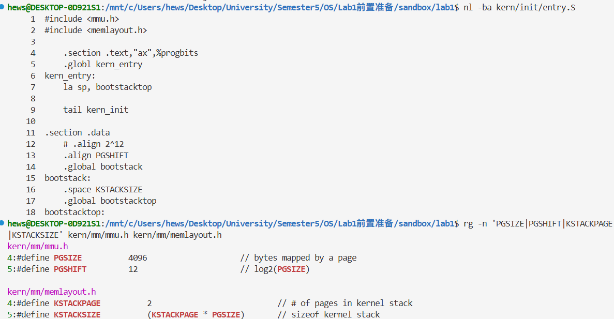

图 1：入口源码、启动栈定义与相关宏

这样做的原因是：OpenSBI 交接时 `sp` 仍指向固件自己的栈（实测为
`0x80045e30`），这块内存属于固件，内核不能继续使用。而后面马上要进入 C 函数，
C 代码保存返回地址、存放局部变量都离不开栈，所以必须先给内核一个自己的栈。

反汇编显示 `la` 被展开为两条指令：

```text
0x80200000 <kern_entry>:    auipc sp,0x3
0x80200004 <kern_entry+4>:  mv    sp,sp
```

`auipc` 得到 $\mathtt{0x80200000} + \mathtt{0x3000} = \mathtt{0x80203000}$；
第二条原本是 `addi sp,sp,0`，因为低 12 位偏移为 0，反汇编显示成了 `mv`。
用 PC 相对寻址计算地址，意味着这段代码不依赖于绝对地址的硬编码。

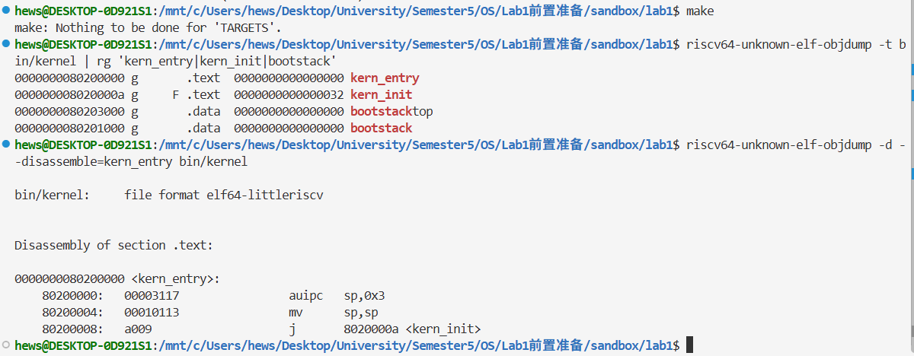

图 2：ELF 符号与 `kern_entry` 反汇编

#### `tail kern_init` 的操作与目的

`tail` 是尾调用伪指令，效果是跳转到 `kern_init`，但不把返回地址写进
`ra`（展开形式为 `auipc t1, ...` 加 `jr t1`，用的是 `t1`）。
本次链接器做了松弛优化，目标距离很近，最终只剩一条压缩跳转
`j 0x8020000a`。

不用 `call` 的原因是 `kern_entry` 后面没有任何代码需要执行，
`kern_init` 也不会返回。用 `call` 会写入一个永远用不上的返回地址，
`tail` 则把控制权直接交出去。

#### GDB 验证

在 `kern_entry` 设硬件断点，分别在入口处、执行完 `la` 对应的两条指令后、
执行完跳转后查看寄存器，结果如下：

| 时刻 | PC | SP | RA |
| --- | --- | --- | --- |
| 入口指令执行前 | `0x80200000` | `0x80045e30` | `0x80005b52` |
| `stepi 2` 之后 | `0x80200008` | `0x80203000` | `0x80005b52` |
| 再 `stepi` 一次 | `0x8020000a` | `0x80203000` | `0x80005b52` |

`p $sp == (unsigned long)&bootstacktop` 结果为 1，说明栈已设到栈顶；
跳转后 PC 等于 `&kern_init`，而 RA 与入口时相同，说明 `tail` 确实没有改写
`ra`。GDB 在 SP 旁边标注 `<SBI_CONSOLE_PUTCHAR>`，是因为这个全局变量在
`.sdata` 中紧跟启动栈，地址恰好也是 `0x80203000`，并不代表栈设错了。

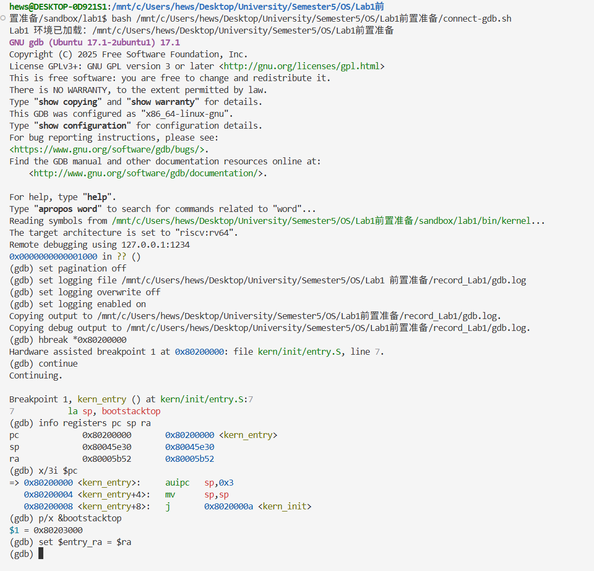

图 3：命中 `kern_entry` 断点时的寄存器

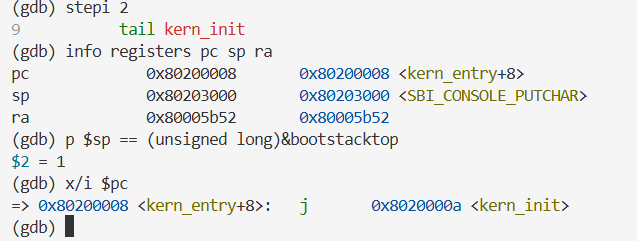

图 4：执行 `la` 对应的两条指令后，SP 等于 `bootstacktop`

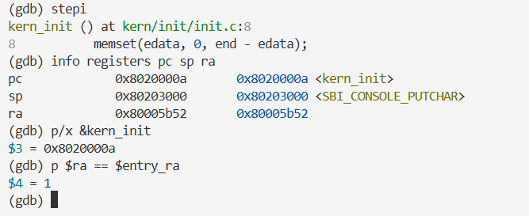

图 5：尾跳转后 PC 到达 `kern_init`，RA 不变

完整的 GDB 输出见 `record_Lab1/logs/gdb.log`。

### 练习二：使用 GDB 验证启动流程

**负责人：**陈彦兴、何闻硕

一个终端启动 QEMU 并让 CPU 暂停在复位状态，另一个终端用 GDB 连接[[1]](#参考文献)，
具体命令见[“复现方法”](#复现方法)一节。下面按执行顺序列出观察结果，较长的输出只保留相关部分。

#### 复位地址与最初六条指令

```text
(gdb) x/10i 0x1000
   0x1000: auipc t0,0x0
=> 0x1004: addi  a2,t0,40
   0x1008: csrr  a0,mhartid
   0x100c: ld    a1,32(t0)
   0x1010: ld    t0,24(t0)
   0x1014: jr    t0
(gdb) x/2gx 0x1018
0x1018: 0x0000000080000000  0x0000000087e00000
```

这段输出采集时第一条已经执行，PC 停在 `0x1004`；重新启动 QEMU 后连接，
PC 为 `0x1000`、SP 为 0，即复位地址就是 `0x1000`。各指令的作用：

| 地址 | 指令 | 作用 |
| --- | --- | --- |
| `0x1000` | `auipc t0,0x0` | `t0` = 当前 PC = `0x1000` |
| `0x1004` | `addi a2,t0,40` | `a2` = `0x1028`，启动信息结构的地址 |
| `0x1008` | `csrr a0,mhartid` | `a0` = 当前 hart 编号，本次为 0 |
| `0x100c` | `ld a1,32(t0)` | 从 `0x1020` 读出设备树地址 `0x87e00000` |
| `0x1010` | `ld t0,24(t0)` | 从 `0x1018` 读出固件入口 `0x80000000` |
| `0x1014` | `jr t0` | 跳转到 OpenSBI |

`0x1018` 之后存放的是数据。若继续用 `x/i` 反汇编，会出现 `unimp`
之类的指令，那是把数据当成指令解码的结果，CPU 不会执行到这里。
这段复位代码和后面的数据都由 QEMU 生成[[2]](#参考文献)。`0x1028` 起是交给固件的
启动信息，读出的前两个双字为 `0x4942534f`（ASCII 为 `OSBI`）和版本号 2。

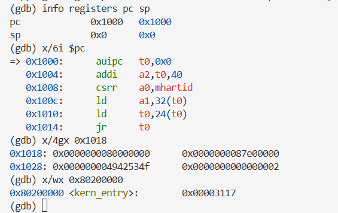

图 6：复位时的 PC/SP、六条复位指令、跳板数据与运行前的内核入口字

#### 进入 OpenSBI

`stepi 5` 停在 `jr t0` 之前，此时 `t0=0x80000000`、`a0=0`、
`a1=0x87e00000`、`a2=0x1028`（图 7）。再单步一次，PC 变为 `0x80000000`，
寄存器的相关部分：

```text
ra             0x0          0x0
sp             0x0          0x0
t0             0x80000000   2147483648
a0             0x0          0
a1             0x87e00000   2279604224
a2             0x1028       4136
pc             0x80000000   0x80000000
```

参数与复位代码准备的一致，`sp` 仍为 0，任何栈都还没有建立。
固件入口处的反汇编（节选）：

```text
(gdb) x/30i 0x80000000
   0x80000000: add s0,a0,zero
   0x80000004: add s1,a1,zero
   0x80000008: add s2,a2,zero
   0x8000000c: jal 0x80000678
   0x80000010: add a6,a0,zero
   0x80000014: add a0,s0,zero
   0x80000018: add a1,s1,zero
   0x8000001c: add a2,s2,zero
   ...
```

OpenSBI 先把三个参数存到 `s0`--`s2`，调用内部函数后再恢复。
这是固件代码，和实验中的 `entry.S` 无关。固件的初始化过程较长，没有逐条单步。

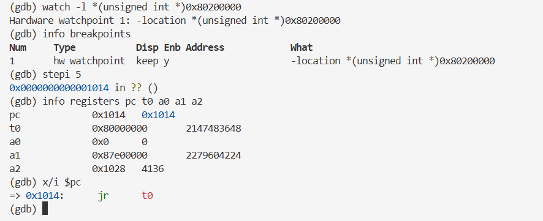

图 7：设置观察点、执行 `stepi 5` 后 `jr t0` 前的参数

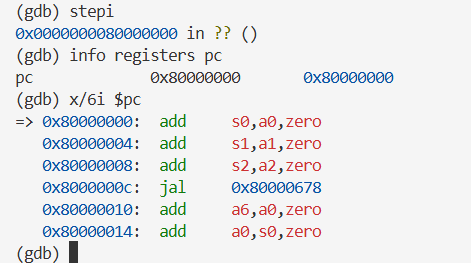

图 8：执行 `jr t0` 后进入 OpenSBI 第一条指令

#### OpenSBI 通过 `mret` 交出控制权

为了找到固件交接的位置，在固件的 `mret` 指令（本次固件中位于 `0x80005b7a`）
设条件硬件断点 `hbreak *0x80005b7a if $mepc == 0x80200000`，
同时在 `0x80200000` 设硬件断点。继续运行后停在 `mret` 处：

```text
pc       0x80005b7a
mepc     0x80200000
mstatus  0x8000000a00006800   ... MPP:1 ...
sp       0x80045e30
=> 0x80005b7a:  mret
(gdb) p/x ($mstatus >> 11) & 3
$1 = 0x1
```

`mepc` 已设为内核入口，`mstatus.MPP` 为 1，即 S 模式。`mret`
执行时，CPU 把特权级切到 MPP 指定的模式，并把 PC 设为 `mepc`[[3]](#参考文献)。

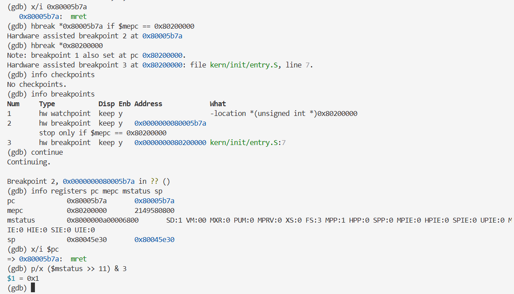

图 9：固件执行 `mret` 前的 `mepc`、`mstatus` 与 MPP 字段

OpenSBI 的串口输出中，`Domain0 Next Address` 为 `0x80200000`，
`Domain0 Next Mode` 为 `S-mode`，与寄存器观察一致。

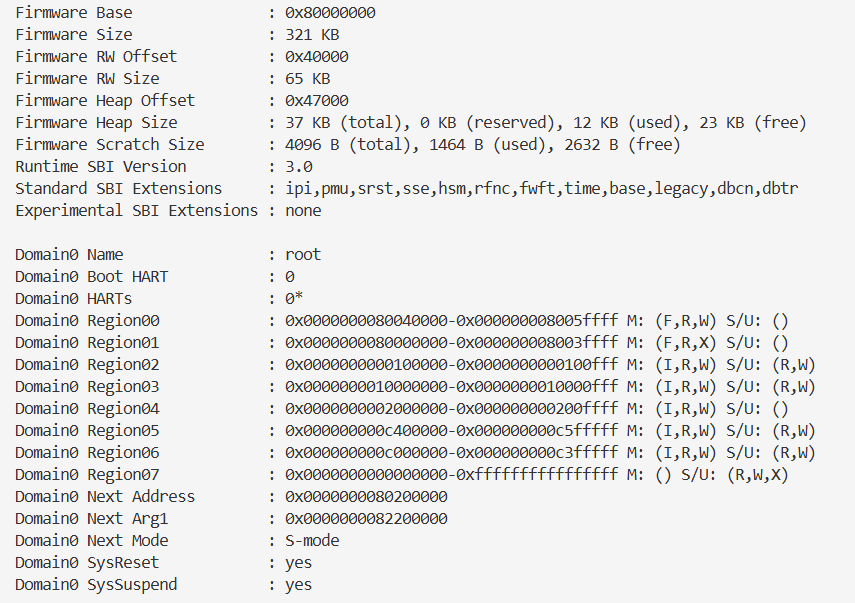

图 10：OpenSBI 输出的固件基址与下一阶段地址、模式

图中 `Next Arg1` 为 `0x82200000`，而复位阶段 `a1` 是
`0x87e00000`。两者属于不同阶段：前者是固件准备交给内核的设备树地址，
FW_JUMP 固件可以配置这个位置[[4]](#参考文献)。我们只记录了两个阶段的实际值，
没有进一步跟踪设备树的复制过程。

#### 到达内核入口

```text
(gdb) x/10i $pc
=> 0x80200000 <kern_entry>:    auipc sp,0x3
   0x80200004 <kern_entry+4>:  mv    sp,sp
   0x80200008 <kern_entry+8>:  j     0x8020000a <kern_init>
   0x8020000a <kern_init>:     auipc a0,0x3
   0x8020000e <kern_init+4>:   addi  a0,a0,-2
   0x80200012 <kern_init+8>:   auipc a2,0x3
   0x80200016 <kern_init+12>:  addi  a2,a2,-10
   0x8020001a <kern_init+16>:  addi  sp,sp,-16
   0x8020001c <kern_init+18>:  li    a1,0
   0x8020001e <kern_init+20>:  sub   a2,a2,a0
```

单步执行 `mret` 后 PC 为 `0x80200000`，箭头指向内核第一条指令，
它还没有执行。这时 `sp` 仍是固件栈 `0x80045e30`，与练习一的观察一致。

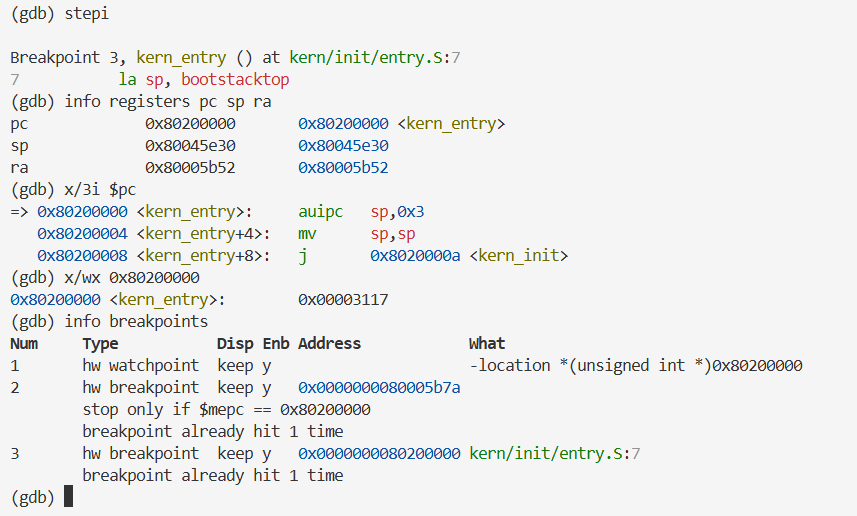

图 11：`mret` 后到达内核入口，入口指令字与断点命中统计

另外，在 CPU 还停在 `0x1000` 时，`x/wx 0x80200000` 就已经读到
`0x00003117`（即 `auipc sp,0x3` 的编码）。我们对这 4 字节设了
观察点，整个启动过程中它没有被触发。这说明镜像在 CPU 开始执行前已由 QEMU loader
放好，OpenSBI 没有改动入口处的内容。观察点只覆盖这 4 字节，而且只在值变化时触发，
所以这个结论只针对入口指令本身[[5]](#参考文献)。

指导书[[6]](#参考文献)的提示认为内核由 SBI 加载到 `0x80200000`，并建议用
`watch *0x80200000` 观察加载瞬间。这适用于由固件搬运内核的配置。
本实验的 Makefile 用 `-device loader` 让 QEMU 在 CPU 运行前写入镜像[[7]](#参考文献)，
所以观察点没有可捕获的变化。我们改用 `mret` 处的条件断点和
`0x80200000` 处的断点来确认交接时刻。
练习二的完整 GDB 输出见 `record_Lab1/logs/exercise2-reset-gdb.log`。

#### 问题回答

RISC-V 硬件加电后最先执行的指令位于 `0x1000`--`0x1014`，共 6 条，
由 QEMU 生成。它们的功能是：读取 hart ID 放入 `a0`，把设备树地址放入
`a1`，把启动信息地址放入 `a2`，从紧跟其后的数据区读出固件入口地址
`0x80000000` 并跳转过去。之后 OpenSBI 在 M 模式下初始化，设置
`mepc=0x80200000`、`MPP=S`，通过 `mret` 进入内核第一条指令。

### 补充观察：内核初始化、输出与死循环

#### BSS 清零的参数

上面 `kern_init` 的反汇编中，`a0` 由 $\mathtt{0x8020000a} + \mathtt{0x3000} - 2$
得到 `0x80203008`，即 `edata`；`a2` 由
$\mathtt{0x80200012} + \mathtt{0x3000} - 10$ 得到同一个地址，即 `end`；
`a1` 为 0。`sub a2,a2,a0` 之后长度为 0，所以这次
`memset(edata, 0, end - edata)` 实际上什么也没清。原因是当前程序的全局变量
（如 `SBI_CONSOLE_PUTCHAR` 等）都有初值，放在 `.sdata` 里，`.bss` 是空的。

#### 格式化输出调用

```text
0x0000000080200036 <+44>: 01e000ef jal 0x80200054 <cprintf>
0x000000008020003a <+48>: a001     j   0x8020003a <kern_init+48>
```

`jal` 调用 `cprintf`，返回地址 `0x8020003a` 写入 `ra`。
字符串由 `cprintf` 及其下层函数输出；第二条是跳转到自身的指令，
就是源码中的 `while (1);`。

#### 在 OpenSBI 中无法回溯

```text
(gdb) finish
"finish" not meaningful in the outermost frame.
(gdb) bt
#0  0x000000008000caae in ?? ()
```

跟踪字符输出时，PC 进入了 OpenSBI 的地址范围（`ecall` 之后由固件处理）。GDB 只加载了内核的符号，
不认识固件代码，也就无法展开调用栈，于是把当前帧当成了最外层，`finish` 报错。
这个提示只是 GDB 缺少调试信息，并不说明程序真的处在最外层函数。
要回到内核，可以在 `0x8020003a` 设断点后 `continue`。

#### 输出完成后的执行位置

```text
(gdb) x/10i $pc
=> 0x8020003a <kern_init+48>: j     0x8020003a <kern_init+48>
   0x8020003c <cputch>:      addi  sp,sp,-32
   0x8020003e <cputch+2>:    sd    ra,24(sp)
   0x80200040 <cputch+4>:    sd    a1,8(sp)
   0x80200042 <cputch+6>:    jal   0x80200088 <cons_putc>
   ...
```

输出结束后 PC 停在跳转到自身的指令上。后面的 `cputch` 只是在内存中恰好相邻的
另一个函数，`x/10i` 连续反汇编时被一并显示出来，CPU 并不会顺序执行到那里。

### AI 辅助学习与调试过程

本实验没有编写或修改内核代码，因此不涉及功能实现的提示词和代码迭代。
AI 主要用在三个方面：解释 `la`、`tail`、`mret` 等指令和
OpenSBI 的交接机制；根据我们贴出的 GDB 输出帮忙分析现象；整理实验记录和报告文字。

下面几处是借助 AI 理解时容易出错、后来对照源码和 GDB 结果才确认的地方：

- 启动栈的位置。容易误以为启动栈在 `0x80000000` 附近。 查看链接脚本和 `nm` 输出后确认，启动栈在内核 `.data` 段中， 地址为 `0x80201000`--`0x80203000`，`0x80000000` 是 OpenSBI 的位置。
- `0x1018` 之后的 `unimp`。反汇编输出容易被理解为复位代码的一部分， 用 `x/2gx` 按数据查看后才确认那里存的是两个地址。
- `finish` 的报错。报错信息字面上说处于最外层帧，实际是 GDB 没有固件符号， 不能据此推断程序的调用关系。
- SP 旁的 `<SBI_CONSOLE_PUTCHAR>` 标注。对照符号表后确认只是地址重合。

报告中的地址和寄存器值全部取自实际 GDB 输出和本次构建的符号表，没有使用 AI 推算的数值。

## 测试与验证

### 编译与运行结果

在仓库根目录执行 `make -C lab1 clean` 后重新 `make -C lab1`，
各源文件依次编译，最后链接出 `bin/kernel` 并用 `objcopy` 生成
`bin/ucore.img`，命令退出码为 0：

```text
+ cc libs/sbi.c
+ cc libs/string.c
+ ld bin/kernel
riscv64-unknown-elf-objcopy bin/kernel --strip-all -O binary bin/ucore.img
```

用与 `make qemu` 相同的参数运行 QEMU，控制台输出（节选）：

```text
OpenSBI v1.8.1
Platform Name               : riscv-virtio,qemu
Firmware Base               : 0x80000000
Runtime SBI Version         : 3.0
Domain0 Next Address        : 0x0000000080200000
Domain0 Next Mode           : S-mode
(THU.CST) os is loading ...
```

内核横幅正常输出。下图是调试过程中的截图，左侧为 QEMU 控制台，右侧为 GDB 会话，
在 GDB 中 `continue` 之后左侧出现了内核输出。

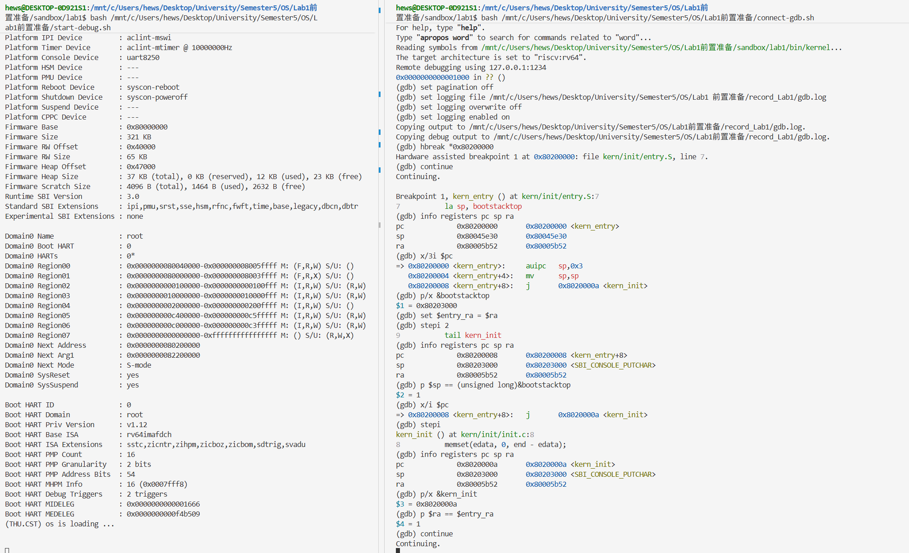

图 12：QEMU 控制台输出与 GDB 调试过程

### 启动流程的 GDB 验证结果

| 阶段 | PC | SP | 依据 |
| --- | --- | --- | --- |
| 复位 | `0x1000` | `0x0` | 新启动 QEMU 后连接 GDB |
| 进入 OpenSBI | `0x80000000` | `0x0` | `jr t0` 后单步 |
| 固件交接前 | `0x80005b7a` | `0x80045e30` | `mepc=0x80200000`，`MPP=1` |
| 内核入口 | `0x80200000` | `0x80045e30` | `mret` 后命中断点 |
| 栈设置后 | `0x80200008` | `0x80203000` | 等于 `&bootstacktop` |
| 进入 C 代码 | `0x8020000a` | `0x80203000` | 等于 `&kern_init`，RA 不变 |
| 输出完成 | `0x8020003a` | -- | 停在 `while (1)` |

### 复现方法

以下命令在仓库根目录执行。构建并查看符号与入口反汇编：

```text
make -C lab1
riscv64-unknown-elf-objdump -t lab1/bin/kernel \
  | grep -E 'kern_entry|kern_init|bootstack'
riscv64-unknown-elf-objdump -d --disassemble=kern_entry lab1/bin/kernel
```

终端 A 启动 QEMU 并暂停 CPU（`fw_jump.bin` 换成本机实际路径）：

```text
qemu-system-riscv64 -machine virt -nographic -bios /path/to/fw_jump.bin \
  -device loader,file=lab1/bin/ucore.img,addr=0x80200000 \
  -gdb tcp:127.0.0.1:1234 -S
```

这里显式指定 FW_JUMP，与采集截图时的配置一致。新版 QEMU 默认使用的 OpenSBI
可能是 FW_DYNAMIC 类型，在只用 loader 装入镜像的情况下，不能保证它会跳到 `0x80200000`。

终端 B 执行 `riscv64-unknown-elf-gdb lab1/bin/kernel`，然后依次输入：

```text
set architecture riscv:rv64
target remote 127.0.0.1:1234
info registers pc sp
x/6i $pc
x/4gx 0x1018
x/wx 0x80200000
watch -l *(unsigned int *)0x80200000
stepi 5
info registers pc t0 a0 a1 a2
stepi
x/6i $pc
x/i 0x80005b7a
hbreak *0x80005b7a if $mepc == 0x80200000
hbreak *0x80200000
continue
info registers pc mepc mstatus sp
p/x ($mstatus >> 11) & 3
stepi
info registers pc sp ra
set $entry_ra = $ra
stepi 2
p $sp == (unsigned long)&bootstacktop
stepi
p/x &kern_init
p $ra == $entry_ra
```

`0x80005b7a` 是本次固件中 `mret` 的地址，换固件后要先重新找到交接处的
`mret`。最后 `detach`，QEMU 继续运行并输出内核横幅；在终端 A 按
`Ctrl+A` 后按 `X` 退出。

### 验证范围与未执行项目

- 已验证：干净编译、QEMU 运行输出，以及从复位到 `kern_init` 死循环的完整 GDB 跟踪。
- GDB 跟踪是在小组另一台机器上完成的（QEMU 10.2.1，固件为 OpenSBI FW_JUMP）， 编译与运行结果来自上表所列环境。`0x80005b7a`、`0x80045e30` 等固件内部地址 与固件版本有关，换环境后需要重新定位；内核符号地址由链接脚本决定，两边一致。
- 未单步跟踪 OpenSBI 内部的初始化过程，只观察了它的入口和交接点。
- 原始截图和日志保存在 `doc/lab1/record_Lab1/`， `evidence-manifest.json` 记录了每个文件的大小和 SHA-256，报告中的截图未经裁剪或修改。
- 本实验目录中没有评分脚本 `tools/grade.sh`，未运行 `make grade`。

## 实验总结与收获

### 实验知识点与操作系统原理的联系和差异

- **启动过程**：原理课讲的是 BIOS 加载引导程序、引导程序加载内核。 本实验对应的是复位代码 $\rightarrow$ OpenSBI $\rightarrow$ 内核，分工类似， 但内核由 QEMU 直接放入内存，OpenSBI 不负责从磁盘读取内核，这一点和 x86 上 BIOS + bootloader 读盘的流程不同。
- **特权级**：原理课只区分内核态和用户态。RISC-V 有 M、S、U 三级， 本实验中固件运行在 M 模式，内核运行在 S 模式，从 M 到 S 的切换通过 `mret` 和 `mstatus.MPP` 完成。
- **系统调用与固件接口**：内核用 `ecall` 请求 OpenSBI 输出字符， 形式上和用户程序通过系统调用请求内核服务是一样的，只是发生在 S 到 M 之间。
- **内存布局**：链接脚本决定了内核各段的地址，C 代码需要的栈和清零的 BSS 都依赖这里导出的符号。原理课中“程序装入内存”的过程在这里要手工写出来。
- **栈与调用约定**：没有栈就不能运行 C 代码，所以入口汇编的第一件事就是设置 `sp`。`tail` 与 `call` 的区别也来自调用约定中 `ra` 的用法。

### 重要但本实验尚未涉及的操作系统知识点

本实验的内核没有中断和异常处理，也没有时钟，不能做任何调度；没有页表，
运行在物理地址上，`satp` 未开启分页；没有物理内存管理和堆分配；
没有进程、线程和用户态程序，也没有文件系统和设备驱动，串口输出完全依赖 OpenSBI。
这些内容会在后续实验中陆续加入。

### 调试中遇到的问题与解决方法

- **调试会话状态不对**：第一次做练习二时，GDB 连上后 PC 是 `0x8020003a`，也就是内核死循环的位置，原因是 QEMU 已经运行过一遍。 退出旧的 GDB 和 QEMU，重新用 `-S` 启动后，确认 PC 为 `0x1000`、 SP 为 0，再开始记录。排查时的旧日志保留在 `record_Lab1/logs/diagnostics/exercise2-gdb.log`。
- **地址混淆**：`0x1000`、`0x80000000`、`0x80200000` 和启动栈地址容易混在一起。对照链接脚本、`nm` 输出和 OpenSBI 的启动信息， 分别确认它们是复位代码、固件、内核入口和内核数据段中的地址。
- **数据被当作指令**：`x/i` 连续反汇编会把 `0x1018` 后面的数据 显示成指令。改用 `x/gx` 按 8 字节查看后读出了两个地址。
- **在 OpenSBI 中无法回溯**：PC 进入固件后 `bt`、`finish` 都失效。 GDB 没有固件的符号，只能在内核中的地址（如 `0x8020003a`）设断点再 `continue` 回到内核。

### AI 协作经验与个人收获

AI 在解释指令和梳理启动流程时很省时间，但它给出的具体地址和寄存器值经常是按“一般情况”
推出来的，和本次构建并不一致。我们的做法是：概念可以先听 AI 的解释，
数值一律以 GDB 输出和 `nm`、`objdump` 的结果为准，有冲突时回到源码和
链接脚本确认。提问时附上完整的 GDB 输出，比只描述现象更容易得到对得上的解释。

通过这次实验，我们弄清了一个最小内核从上电到打印第一行字之前需要哪些准备：
有人把镜像放进内存，有人把 CPU 切到正确的特权级并跳到入口，入口代码设置好栈，
C 代码才能运行。也熟悉了用 GDB 调试裸机程序的方法，包括硬件断点、条件断点、
观察点以及查看 CSR 寄存器。

## 参考文献

1. [QEMU GDB 调试说明](https://www.qemu.org/docs/master/system/gdb.html)
2. [QEMU 10.2.1 源码 hw/riscv/boot.c](https://github.com/qemu/qemu/blob/v10.2.1/hw/riscv/boot.c)
3. [The RISC-V Instruction Set Manual, Volume II: Privileged Architecture (20240411)](https://docs.riscv.org/reference/isa/v20240411/_attachments/riscv-privileged.pdf)
4. [OpenSBI FW_JUMP Firmware 说明](https://github.com/riscv-software-src/opensbi/blob/master/docs/firmware/fw_jump.md)
5. [GDB 文档：Setting Watchpoints](https://sourceware.org/gdb/current/onlinedocs/gdb.html/Set-Watchpoints.html)
6. [riscv64-ucore 操作系统实验指导书：Lab1 最小可执行内核](http://8.135.34.58/lab2026/_book/lab1/lab1.html)
7. [QEMU Generic Loader 文档](https://www.qemu.org/docs/master/system/generic-loader.html)
