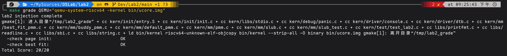

# 操作系统实验报告：Lab2 物理内存和页表

## 实验基本信息

| 项目 | 内容 |
|------|------|
| 实验名称 | Lab2：物理内存和页表 |
| 小组成员 | 2413597-白景仁、2412731-陈彦兴、2411783-何闻硕 |
| 完成日期 | 2026-10-22 |

### 小组分工

| 成员 | 负责的练习/模块 | 对应提交 |
|------|----------------|----------|
| 何闻硕（`hews`） | 练习一：Sv39 启动映射修复、`page_init()` 物理页初始化；Challenge：SLUB 对象分配器；修复 First Fit 尾插缺陷 | `be87b20`（初始化与启动映射）、`2c1fcc8`（First Fit 修复）、`f8ac65b`/`8da9632`/`ab13a6d`（SLUB） |
| 白景仁（`baijingren`） | 练习二：Best Fit 完整实现（初始化、登记、选块与分配拆分、释放与相邻块合并），切换管理器；Best Fit 黑盒对抗测试 | `e066a16`（Best Fit，main 上由 `0fcfee2` 变基而来）、`fd6fb06`（测试） |
| 陈彦兴（`cyx`） | Challenge：Buddy System 及主机回归 | `aea6a3e`、`4b6f25f` |

何闻硕另外完成了启动映射与 `page_init()`，这是三个分配器共同的前置。

---

## 一、实验目的

1. 理解 RISC-V 启动阶段 Sv39 页表、虚拟地址与物理地址的关系，能解释为什么开启分页后必须保证 PC 所在地址仍可取指。
2. 理解物理页描述符 `struct Page` 的作用，掌握根据设备树（DTB）给出的内存范围建立描述符数组、区分保留页与空闲页的方法。
3. 读懂 First Fit 连续物理页分配器，实现并验证 Best Fit，理解拆分、合并、碎片与算法开销。
4. 实现 Buddy System 与 SLUB 两个 Challenge，理解页级分配与对象级分配的分层。
5. 用 AI 辅助编写规格化提示词、生成代码与测试，并用真实的编译、运行结果核对 AI 的输出。

---

## 二、实验环境

### 系统工具

| 软件 | 版本 |
|------|------|
| riscv64-unknown-elf-gcc | 14.2.0 |
| qemu-system-riscv64 | 10.2.1 |
| 固件 | OpenSBI（`-bios default`），启动时由 QEMU 交接 DTB 地址 |

> 在较新的 QEMU 下，Makefile 的 `-device loader` 启动方式会使 OpenSBI 的 `Next Address` 为 0，内核不会运行。测试时改用 `-kernel bin/ucore.img`，例如 `make qemu QEMU="qemu-system-riscv64 -kernel bin/ucore.img"`。

### AI 工具

| 成员 | AI 编程工具 | 底层模型 |
|------|------------|---------|
| 2413597-白景仁 | Claude Code | Claude Opus 5.5 |
| 2412731-陈彦兴 | Claude Code | DeepSeek Flash |
| 2411783-何闻硕 | Codex | GPT 6.1 Sol |

---

## 三、实验整体逻辑分析

### 3.1 本章节的逻辑主线

Lab2 回答的问题是：内核怎样知道“哪些物理内存可以用”，又怎样把它们按页分给别人。整条调用链为：

OpenSBI 交接 hart ID 与 DTB 地址
 → entry.S 建立 Sv39 根页表并写 satp，跳到高地址
   → kern_init → pmm_init → init_pmm_manager（选择分配器）
     → page_init：解析 DTB，建立 pages[] 描述符数组，把可用页交给 init_memmap
       → alloc_pages / free_pages：由具体管理器（First/Best Fit、Buddy）实现
         → kmalloc / kfree：SLUB 在页分配器之上再分一层对象


地址层面，内核链接在 `0xffffffffc0200000`，被装载在物理地址 `0x80200000`。分页打开之前的取指走物理地址，打开之后走虚拟地址，所以启动阶段需要两份映射同时存在。

### 3.2 功能的逐步实现

1. 先修启动映射。第一次编译成功后 QEMU 停在固件输出，GDB 显示写 `satp` 之后 PC 指向的地址已经取不到指令。这一步不通，后面的东西都没法在真实机器上跑。
2. 再实现 `page_init()`，让分配器知道有多少页、描述符放在哪、哪些页已经被内核占掉。做完先用框架自带的 First Fit 跑一遍，确认交出来的空闲页是对的。
3. 然后读 First Fit、写 Best Fit。两者共用同一套链表和 `init_memmap`，只有选块那一行不同，所以放在初始化稳定之后做，出问题也容易排除是初始化的锅。
4. 再补 Best Fit 的独立测试。框架的 `best_fit_check` 基本只覆盖整块分配，切分后的余块形态没有断言，得自己补黑盒用例。
5. 最后做 Buddy 和 SLUB。前者换掉整个页级策略，后者在页级接口上再叠一层对象分配，都依赖前面已经稳定。

---

## 四、实验内容与实现

### 功能模块一：启动映射与物理页初始化

负责人：2411783-何闻硕

#### 模块功能描述

##### 涉及的函数和文件

```c
// lab2/kern/mm/pmm.c
static void page_init(void);
// lab2/kern/init/entry.S：根页表与 satp 设置
```

##### 功能说明

`page_init()` 读取 DTB 中的内存起点和大小，计算物理页号上界 `npage`，在内核 `end` 之后按页对齐放置 `pages[]`，先把全部描述符标记为保留，再把描述符数组之后的完整页交给 `init_memmap()`。

默认 128 MiB 启动的数值：

| 项目 | 值 |
|---|---|
| 内存范围 | `[0x80000000, 0x88000000)` |
| `nbase` / `npage` | `0x80000` / `0x88000` |
| 描述符数量 | 32768（`sizeof(struct Page)` = 40 字节） |
| 空闲页 | 31929（后续加入 SLUB 后内核变大，为 31927） |

`npage` 是页号上界而不是页数，描述符个数为 `npage - nbase`。

##### 初始化的顺序与计算

1. 读取 DTB 内存起点与大小，得 `mem_end`，`npage = PPN(mem_end)`，`nbase = PPN(DRAM_BASE) = 0x80000`。
2. `pages[]` 放在内核链接符号 `end` 向上按页对齐之后，大小为 `32768 × 40` 字节；用 `PADDR()` 把虚拟地址换成物理地址，得到管理数组占用的物理区间。
3. 先把全部描述符标记为保留，再用 `pa2page` 找到管理数组之后第一个完整页，只把 `[空闲起点, mem_end)` 清除保留标志并交给 `init_memmap()`。这样内核镜像、管理数组本身以及任何未明确开放的页，默认都不会被分配出去。
4. 空闲起点向上取整、终点向下取整，只开放完整页；内存大小或内核体积变化后这些数值随之变化，算法不依赖示例地址。

启动这块，Sv39 把 39 位虚拟地址分成 `9+9+9+12` 位。当前启动只用一张根页表，每个叶项直接映射 1 GiB：索引 511 对应高地址 `0xffffffffc0000000`，索引 2 对应物理 `0x80000000`。修复前只有索引 511，写 `satp` 之后 PC 的低地址取不到指令；补上索引 2 的身份映射后，入口才能执行到跳转高地址的那一步，高地址运行之后身份映射并未撤销。

64 MiB 启动的对照结果为 16384 个描述符、15705 个空闲页。

#### 最终提示词

见 [prompt.md](prompt.md)。

#### 实现迭代过程

##### 第一次迭代：启动即停住

遇到的问题：

- 编译成功，但 QEMU 停在固件输出。用 GDB 在 `0x80200034` 命中写 `satp` 的指令，单步后 PC 为 `0x80200038`，该地址已无法取指。
- 原因：原始根页表只有索引 511 的高地址叶项；写 `satp` 不会自动修改 PC，而 PC 仍是物理地址形式。

解决策略：

- 在 `entry.S` 的根页表索引 2 增加覆盖同一物理 1 GiB 的身份映射，保留索引 511。入口因此能继续执行刷新 TLB、设置高地址栈并跳转的指令。

最终结果：

- ✅ 编译通过
- ✅ 原 First Fit 自检输出 `check_alloc_page() succeeded!`
- ✅ 128 MiB 与 64 MiB 启动均通过

关键改进点：

1. 把“分页打开后 PC 为什么取不到指令”这个现象交给 GDB 验证，而不是凭 AI 猜测原因。
2. 对内存起点和范围加断言，防止把不能映射的页纳入管理。

---

### 功能模块二：Best Fit

负责人：2413597-白景仁

#### 模块功能描述

##### 涉及的函数

```c
static void best_fit_init(void);
static void best_fit_init_memmap(struct Page *base, size_t n);
static struct Page *best_fit_alloc_pages(size_t n);
static void best_fit_free_pages(struct Page *base, size_t n);
static size_t best_fit_nr_free_pages(void);
static void best_fit_insert_block(struct Page *base);   // 按地址有序插入
// 以及 pmm.c::init_pmm_manager() 中切换到 best_fit_pmm_manager 的一行
```

##### 功能说明

空闲链表按块首页描述符地址升序排列，每个空闲块只有首页带 `PG_property`，`property` 是块的页数。`best_fit_alloc_pages(n)` 遍历整条链表，在所有 `property >= n` 的块中选最小者；遇到恰好等于 `n` 的块就提前结束，因为它不可能被更小的块超越。

- 块恰好等于 n：整块摘下。
- 块大于 n：从块前部切出 `n` 页，余块首页 `page + n` 置 `property - n` 并重新挂回被摘块的原位置，保持地址有序，不需要重新扫描。
- 没有足够大的块（含 `n > nr_free`）：返回 `NULL`，链表和 `nr_free` 都不改变。

和 First Fit 的差别就在选块那一行：

```c
// First Fit：遇到首个足够大的块就停止
if (p->property >= n) { page = p; break; }
// Best Fit：遍历全程，保留最小的足够大块
if (p->property >= n && (page == NULL || p->property < page->property)) {
    page = p;
    if (p->property == n) break;
}
```

几个典型场景的追踪（页数表示 `property`，`@` 后为块首位置）：

| 场景 | 初始空闲链表 | 请求 | 结果 |
|---|---|---|---|
| 精确匹配 | `{3@p0, 2@p0+4}` | `alloc 2` | 返回 `p0+4`，链表剩 `{3@p0}` |
| 较大块拆分 | `{5@p0}` | `alloc 2` | 返回 `p0`，余块 `{3@p0+2}` |
| 多个候选块 | `{2@p0+1, 1@p0+4}`（`best_fit_check`） | `alloc 1` 再 `alloc 2` | 先返回 `p0+4`，再返回 `p0+1` |
| 没有足够块 | `{2@p0+1, 1@p0+4}` | `alloc 4` | 返回 `NULL`，状态不变 |

##### 登记与释放合并

- `init_memmap`：要求区间各页处于 Reserved；清零 `flags/property/ref`，`base->property = n` 并置 `PG_property`，`nr_free += n`，按地址有序插入链表。
- `free_pages`：要求各页非 Reserved 且非 Property（即已分配）；清零后同样按地址有序插入，然后做相邻合并：
  - 与前块合并：`p + p->property == base`；
  - 与后块合并：`base + base->property == p`；
  - 合并时清除被吸收块首页的 `PG_property` 并从链表摘除。

链表里的“指针相邻”等价于物理地址相邻，因为 `pages[]` 是按物理页号连续排列的数组，`base + n` 就是后面第 `n` 页。

释放时的合并分这几种：

| 情况 | 动作 |
|---|---|
| 与前块合并 | 前块 `property += n`，新块首页清标志 |
| 与后块合并 | 新块 `property += 后块 property`，后块首页清标志并摘除 |
| 同时与两侧合并 | 先合前块，再以合并后的块与后块合并 |
| 两侧均不相邻 | 只做有序插入 |

和 First Fit 比，Best Fit 每次都要扫描整条链表（精确匹配时可提前结束），查找代价为 `O(空闲块数)`，First Fit 平均更快；但 Best Fit 倾向于把最贴合的块用掉，大块得以保留。它的局限是切分后容易留下大量过小的余块（外部碎片），小块无法再满足请求。

##### 对“First Fit / Best Fit 是否有改进空间”的思考

- 链表扫描可以改为按大小组织的结构（按块大小分桶的多条链表，或平衡树），选块时间降到 `O(log n)`，代价是合并时要同步维护两套索引。当前实验的页数规模下没有必要，因此未实现。
- 保留一个“上次分配位置”的游标（Next Fit）能缩短 First Fit 的平均扫描，但会使低地址空洞更难复用。
- 想真正减少外部碎片得换策略，比如 Buddy System（见 Challenge）以内部碎片换取 `O(log n)` 的合并与分配。

#### 最终提示词

见 [prompt.md](prompt.md)。

#### 实现迭代过程

提示词里把三类分配情形和并列规则写清楚了，几个取舍（余块放回原位置、精确匹配提前结束、不引入按大小排序的第二条链表）记在 `openspec/changes/add-best-fit-pmm/design.md`。

框架自带的 `best_fit_check` 只覆盖“恰好整块”的分配，切分路径几乎没有断言，跑通它并不能说明实现是对的。写测试之前先把目标文档和 14 个设计样例过了一遍，发现有几个样例本身就会误杀正确实现：AT-P2-02 把“并列任取其一”当成漏洞，AT-P2-04 释放中间 2 页后应该是 6 页，文档写成了 4 页。改掉这些样例，再按黑盒方式补测试。

合并各人分支时，`best_fit_pmm.c` 里出现了两套 `best_fit_insert_block`、`best_fit_init_memmap`、`best_fit_free_pages`：Git 没报冲突，编译器报重复定义。删除重复函数后全部测试通过。

关键改进点：

1. 提示词里明确“并列时任取其一”，避免测试绑定未承诺的行为。
2. 测试用 `alloc_pages` 取走全部空闲页，在其中划出 64 页试验区，两端各留 1 页 guard，不直接改 `free_list`。
3. 测试夹具先自检（故意改坏 5 种页状态，确认巡检器都能报错），再用来检验分配器。

---

### 练习：理解 First Fit

负责人：何闻硕

First Fit 在 `default_pmm.c` 中实现，函数职责如下：

| 函数 | 作用 |
|---|---|
| `default_init` | 初始化空闲链表为空，`nr_free = 0` |
| `default_init_memmap` | 把 `[base, base+n)` 登记为一个空闲块并按地址插入链表 |
| `default_alloc_pages` | 从链表头向后找到第一个 `property >= n` 的块；大于 `n` 则切分，余块放回原位置 |
| `default_free_pages` | 按地址插入释放的块，然后与前后相邻块合并 |

SLUB 阶段在回归中发现 `default_init_memmap()` 与 `default_free_pages()` 在链表尾部 `list_add()` 之后缺少 `break`，遍历会再次处理刚插入的节点，把它插到自身之后。修复只在两个尾插分支各加一个 `break`，原有的 `basic_check()`、`default_check()` 保持不变。

---

### 练习：Challenge —— 获取物理内存范围

操作系统在不预先知道硬件配置时，可以从下列来源获得可用物理内存范围：

- 设备树（DTB）：RISC-V 平台由固件在启动时把 DTB 地址通过 `a1` 交给内核，内核解析其中的 `memory` 节点（本实验所用方式）；
- BIOS/UEFI 内存映射：x86 上通过 E820 或 UEFI `GetMemoryMap` 获得带类型标记的区间；
- ACPI 表：提供更多平台信息；
- 探测写入：向候选地址写入并读回，用于缺乏固件信息的老式平台，但可能误触设备寄存器，只在受控条件下使用。

得到的范围不能原样交给分配器：还要排除内核镜像、`pages[]` 自身、固件保留区和设备区域，所以 `page_init()` 才先全部标记保留、再开放中间完整页。

---

### Challenge：Buddy System

负责人：2412731-陈彦兴

设计要点：

- `MAX_ORDER = 15`，每个 order 一条空闲链表；空闲块首页用 `PG_property` 标记，`property` 保存 order；已分配块首页用私有 flag 位标记，`property` 保存分配时的 order，使 `free_pages` 不需要调用者再传大小。
- 伙伴地址按物理页号异或计算：`buddy_ppn = ppn ^ (1 << order)`。
- `alloc_pages(n)`：向上取整到 `2^k`，从最小可用 order 取块，逐级对半拆分；`free_pages`：按保存的 order 归还，沿伙伴逐级合并。
- 不使用 `__builtin_clz/ctz`（`-nostdlib` 下缺符号），用循环实现 log2。
- 通过 `USE_BUDDY_PMM` 编译开关选择，默认构建不变；切换前必须 `make clean`，因为 Makefile 不跟踪编译宏变化。

内部碎片是该算法本身的代价：`alloc_pages(5)` 实际占用 8 页。

实现提示词（Prompt 1）给出背景与约束（不修改 `best_fit_pmm.c`、`default_pmm.c`、`page_init()` 和现有测试）、`MAX_ORDER`、两类标志位的约定、`init_memmap`/`alloc`/`free`/`check` 的行为，以及“不用 `__builtin_clz/ctz`、通过 `-Wall -Werror`”的工程约束。测试提示词（Prompt 2）要求内核内 `buddy_check()` 与主机端 `test_buddy_host.c`（256 个 `struct Page` + 桩函数，开启 ASan/UBSan），覆盖初始化、分配、释放合并、随机和诊断输出。完整原文见 `lab2/report/buddy.md` 第二、三节。

#### 测试覆盖

- 内核内 `buddy_check()`：扫描各 order 链表检查块首、对齐、范围、`property` 与标志；用临时 flag 位检测块重叠；检查不存在两个同 order 的伙伴同时空闲（否则说明漏合并）；分配 1+1 页、5 页（取整 8）、3 页（取整 4）后分别释放；`n=0`、`n>nr_free` 的失败路径。
- 主机回归：256 页初始为一个 order-8 块；两次分配 1 页，第二次必须返回伙伴页，释放第一页时伙伴仍占用不得合并，释放第二页后恢复；整块分配 256 页后再分配失败；2000 次固定种子随机，用占用位图逐步断言 `nr_free` 并在结束时恢复。

这个实现有几处边界：`free_pages` 按保存的 order 归还整块，`n` 只用于校验；`MAX_ORDER=15`，单次最多 32768 页；默认构建不启用 Buddy，需 `make BUDDY=1`。

验证结果：

| 项目 | 结果 |
|---|---|
| `make BUDDY=1` | 退出 0 |
| QEMU 128 MiB | `memory management: buddy_pmm_manager`、`check_alloc_page() succeeded!` |
| QEMU 64 MiB | 16384 个描述符、15705 空闲页，自检通过 |
| 主机回归（ASan/UBSan） | `Buddy host test: PASS (2000 operations)` |

---

### Challenge：SLUB 对象分配器

负责人：2411783-何闻硕

设计要点（详见 `lab2/report/slub.md`）：

- 两层结构：底层仍是 `alloc_pages/free_pages`，上层提供 `kmalloc(size)` / `kfree(ptr)`。
- 16～2048 字节的 2 次幂大小缓存；每个 slab 占一页，页首 128 字节为元数据，随后是对象槽位；空闲对象的首个指针大小的空间保存下一空闲对象，不需要额外节点。
- 每个缓存维护 partial 链表：填满后移出、释放一个槽位后重新进入、最后一个对象归还时立即释放整页。
- 大于 2048 字节的请求直接申请连续页，页头记录页数，`kfree` 不需要长度。
- `kfree` 先把指针按页向下对齐，再在自己维护的登记链表里查所有权，不读取外来地址；陌生指针、对象内部指针和可检测的重复释放通过 `panic` 拒绝。
- 仅面向无并发场景，未实现 per-CPU、NUMA、锁等。

当前 64 位构建里，slab 元数据 120 字节，对齐后对象起点偏移 128；一页能放的槽位数为 `floor((4096-128)/规格)`：16/32/64/128 字节分别为 248/124/62/31，256/512/1024/2048 字节分别为 15/7/3/1。大对象所需页数为 `ceil((128+size)/4096)`，例如 6000 字节需 2 页。

实现提示词要求两层结构、2 次幂缓存、partial slab 管理、所有权校验、`kmalloc(0)` 返回 `NULL`、溢出检查和不依赖 libc；测试提示词要求按公开行为设计，不复制内部选槽逻辑，覆盖 29 种尺寸、填满多个 slab、full→partial 转换、混合释放后页数恢复、极值、真实耗尽底层页以及固定种子随机，并在独立进程中验证非法释放会 panic。原文见 `lab2/report/slub.md`。

#### 测试要点

| 测试 | 能发现的错误 |
|---|---|
| 29 种尺寸同时持有并按长度写入数据 | 容量不足、越界覆盖、错误取整 |
| 填满多个 slab、释放唯一空槽再申请 | “一对象一页”、partial 未复用、满 slab 未重新登记 |
| 交错释放后检查页数恢复 | 空 slab 未归还、链表状态转换错误 |
| `0`、`NULL`、`SIZE_MAX` 等极值 | 加法溢出与容量不足混淆 |
| 真实耗尽底层页 | 失败后破坏存活对象或泄漏页 |
| 7 类非法释放（独立进程） | 陌生指针、内部指针、重复释放被误接受 |

随机回归在第 32 步发现 4097 字节对象与存活的 7 字节对象重叠，同轮 QEMU 也未能完成耗尽回收测试。GDB 检查后定位到 First Fit 尾插缺陷（见“练习：理解 First Fit”），修复后复验通过。本来以为是 SLUB 的锅，最后发现是页层。

128 MiB QEMU 下 `slub_check() succeeded! free pages restored: 31927`；主机 ASan/UBSan 回归含 22000 次混合操作、7 类预期 panic 与 256 页整体恢复，均通过。

---

## 五、测试与验证

### 5.1 启动与自检

在 `Dev/Lab2/main` 上构建并运行，输出：

```text
memory management: best_fit_pmm_manager
physical memory: [0x0000000080000000, 0x0000000088000000)
page descriptors: 32768, npage: 0x88000
free physical memory: [0x0000000080349000, 0x0000000088000000), 31927 pages
check_alloc_page() succeeded!
...
slub_check() succeeded! free pages restored: 31927
```

### 5.2 原始评分

`make grade` 的两项检查均通过，总分 20/20：



第一次不加参数运行时得 0 分，原因是上面提到的启动方式问题，改用 `-kernel` 后通过。

### 5.3 Best Fit 黑盒测试

`sh test/lab2/run_p2.sh` 结果：`SUMMARY run=30 pass=30 fail=0`。

| 方向 | 用例 | 说明 |
|---|---|---|
| D1 不变量巡检 | 每次 alloc/free 后扫描 | 链表按地址升序、块首标记与 `property`、块不重叠、`Σproperty == nr_free`、相邻块已合并；另有巡检器自检 |
| D2 选择边界 | AT-P2-01/02/03/04/13 等 | 最小块在头/尾/中间、三方并列、并列且需切分、唯一恰等块 |
| D3 合并组合 | AT-P2-05/06/07/08 等 | 只合后、只合前、双侧合并、被已分配页隔开不合并 |
| D4 标志残留 | AT-P2-09/10/14 等 | 切分与乱序合并后逐页检查 `flags/property/ref` |
| D5 随机模型 | 3 个种子 × 1500 次操作 | 测试侧位图模拟 Best Fit，返回块必须是“最小可容纳块”之一 |
| D6 失败路径 | 空集合、`n > nr_free`、总量够但分散 | 失败后逐页比较，状态不变 |

测试不与 First Fit 对拍，因为两种策略会合法地产生不同碎片；把管理器换成 First Fit 时测试应当失败。

### 5.4 其他测试

| 项目 | 结果 | 来源 |
|---|---|---|
| 页初始化，128 MiB / 64 MiB | 自检通过，32768 / 16384 个描述符 | `lab2/report/logs/hews-qemu-*.log` |
| Buddy 主机回归 | PASS，2000 次操作 | `lab2/report/logs/buddy-host.log` |
| SLUB 主机回归 | PASS，另有 7 类预期 panic | `lab2/report/logs/slub-host.log` |

---

## 六、实验总结与收获

### 对操作系统的理解

这部分和 OS 课上的内容大体能对上，但侧重点不太一样。

页表这块，课上重点是地址翻译机制本身，实验里真正卡住的是启动时序：分页一打开，PC 还在物理地址上，下一条指令就取不到了。`struct Page` 和 `pages[]` 对应课堂上的页框管理表，每个物理页一条记录，记录引用数和状态。

分配器这边，First Fit 和 Best Fit 课上归在动态分区分配里，只是这里分配的是连续物理页，而且要靠地址有序链表才能做相邻块合并。合并消掉的只是空闲块之间的外部碎片，已经分出去的页挪不动。Buddy 用内部碎片换更快的分配和合并；SLUB 在页之上再切一层对象，解决页粒度太粗的问题。

缺页处理和页面置换这次没有涉及，留到后面的实验。

### AI 协作开发的经验

- 白景仁：实现提示词写清前置/后置条件和并列规则后，生成的代码目标明确；但通过框架自检不等于正确，切分路径几乎没有断言，需要独立的黑盒测试。让 AI 先把测试样例过一遍再写，发现了会误杀正确实现的样例。
- 何闻硕：AI 给出的启动失败解释要用 GDB 的实际输出核对；SLUB 的测试意外暴露了 First Fit 的尾插缺陷。
