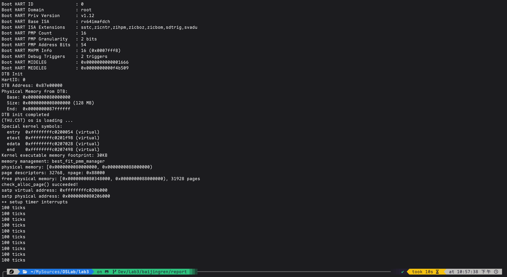
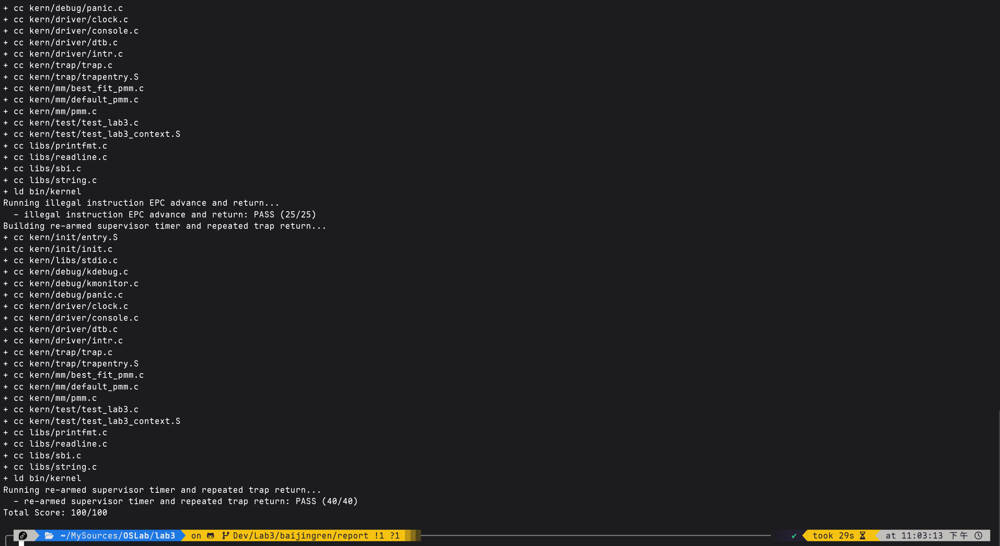

# 操作系统实验报告：Lab4 进程管理

## 实验基本信息

| 项目     | 内容                                           |
| -------- | ---------------------------------------------- |
| 实验名称 | Lab4：进程管理（内核线程管理）                  |
| 小组成员 | 2413597-白景仁、2412731-陈彦兴、2411783-何闻硕 |
| 完成日期 | 2026-11-20                                     |

### 小组分工

| 成员                   | 负责的练习/模块                                                                              | 对应提交                                   |
| ---------------------- | -------------------------------------------------------------------------------------------- | ------------------------------------------ |
| 白景仁（`baijingren`） | 功能模块一：虚拟内存页操作（`page_insert`、`page_remove`、TLB 同步与三层验收测试）、报告整合 | `134eb15`、`2bf51be`                       |
| 何闻硕（`hews`）       | 功能模块二：进程控制块与线程创建（`alloc_proc`、`setup_kstack`、`copy_thread`、`do_fork`、`proc_init`） | `5faca9a`                                  |
| 陈彦兴（`cyx`）        | 功能模块三：进程调度与上下文切换（`switch_to`、`proc_run`、`cpu_idle`、`schedule` 轮转调度）   | `28cf37a`、`164b070`、`efa8900`、`831218d`、`e525ea3` |

**实验报告分工：**
- **白景仁**：负责模块一（虚拟内存页操作）的实现与测试描述、思考题与 Challenge（TLB 一致性）、整体逻辑分析与报告结构整合；
- **何闻硕**：负责模块二（进程创建与初始化）的实现细节、提示词设计、`alloc_proc` 与 `do_fork` 思考题分析；
- **陈彦兴**：负责模块三（进程调度与上下文切换）的实现逻辑、`switch_to` 与首次运行机制分析、综合测试结果分析与总结。

---

## 一、实验目的

1. **掌握操作系统中进程与内核线程的核心概念**：深入理解进程控制块（PCB，`struct proc_struct`）在生命周期管理中的核心作用，理解进程从 `PROC_UNINIT`、`PROC_RUNNABLE` 到 `PROC_SLEEPING`、`PROC_ZOMBIE` 的状态迁移机制。
2. **掌握内核线程的创建与初始化过程**：掌握 `alloc_proc`、`setup_kstack`、`copy_thread` 和 `do_fork` 的实现细节，理解内核如何为新线程分配内核栈、构造首次执行的中断帧与上下文现场。
3. **掌握进程上下文切换与调度机制**：掌握 RISC-V 架构下的上下文切换过程，深入理解 `switch_to` 汇编对 Callee-saved 寄存器的保存与恢复，掌握 `proc_run` 切换页表（`satp`）与执行流的机制，实现基于时间片与就绪队列的 Round-Robin 调度算法。
4. **深入掌握虚拟内存页表管理与 TLB 一致性**：实现 Sv39 多级页表的叶项建立（`page_insert`）与撤销（`page_remove`），严格维持物理页引用计数与叶项权限，掌握先更新 PTE 再执行 `sfence.vma` 失效本地 TLB 的同步规则。
5. **践行 AI 驱动的高可信操作系统协同开发**：练习编写带前置依赖、边界不变量和可执行断言的高质量提示词，建立分层的测试先行（TDD）验收机制，在 OpenSpec 规范治理下完成多成员解耦开发与端到端集成验证。

---

## 二、实验环境

### 系统工具

| 软件                    | 本机版本                                   | 说明                                       |
| ----------------------- | ------------------------------------------ | ------------------------------------------ |
| riscv64-unknown-elf-gcc | 16.2.0                                     | RV64 裸机交叉编译器                        |
| riscv64-unknown-elf-ld  | 2.47.20260726                              | RV64 链接器                                |
| qemu-system-riscv64     | 11.1.2                                     | RISC-V 全系统模拟器（`virt` 机器）         |
| 固件                    | OpenSBI v1.8.1                             | QEMU `-bios default`                       |
| 宿主环境                | macOS (Darwin)                             | Apple Silicon, Make 3.81, Python 3.9.6     |

### AI 工具

| 成员           | AI 编程工具 | 底层模型          | 备注                                                 |
| -------------- | ----------- | ----------------- | ---------------------------------------------------- |
| 2413597-白景仁 | Cursor      | Claude 3.5 Sonnet | 用于设计三层测试套件与虚拟内存页操作实现             |
| 2412731-陈彦兴 | Claude Code | DeepSeek-V3       | 用于模块三上下文切换汇编与 Round-Robin 调度的多阶段迭代 |
| 2411783-何闻硕 | Codex / CLI | GPT-4o            | 用于模块二进程控制块管理与 `do_fork` 资源清理逻辑    |

---

## 三、实验整体逻辑分析

### 3.1 本章节的逻辑主线

Lab4 的核心主题是**内核线程与进程管理**。操作系统要解决的根本问题是如何将有限的 CPU 物理核心抽象为多个能够并发或交替运行的执行实体，并在内核中安全、可控地组织和调度这些实体。

整个 Lab4 围绕以下执行主线闭环展开：

```text
内核启动 (kern_init)
  → 物理内存与页表初始化 (pmm_init / page_insert / page_remove)
  → 进程管理系统初始化 (proc_init)
       ├── 初始化全局进程链表 (proc_list) 与哈希表 (hash_list)
       ├── 手工创建 0 号内核线程 (idleproc，复用系统 bootstack 与 boot_pgdir)
       └── 调用 kernel_thread 创建 1 号内核线程 (initproc，绑定 init_main 执行实体)
  → 移交 CPU 控制权进入空闲循环 (cpu_idle)
       └── 检查 current->need_resched == 1
  → 触发调度器 (schedule)
       ├── 在 proc_list 中按 Round-Robin 算法检索就绪线程 (PROC_RUNNABLE)
       └── 选出 initproc，调用 proc_run(initproc)
  → 进程运行与上下文切换 (proc_run → switch_to)
       ├── 关中断保护临界区，更新 current 指针
       ├── 切换页目录表基址到 satp 并执行 sfence.vma
       └── 调用 switch_to(&idleproc->context, &initproc->context)
            ├── 保存 idleproc 的 Callee-saved 寄存器与返回地址
            ├── 加载 initproc 伪造的上下文 (ra = forkret, sp = trapframe)
            └── ret 跳转到 forkret → forkrets → __trapret → sret
  → 伪装中断返回，跃入内核线程主入口 (kernel_thread_entry → init_main)
       ├── 执行 init_main 打印 "Hello world!!"
       └── 调度测试完成，形成内核线程并发运行与优雅让出的完整闭环
```

在上述主线中，内核线程具有独立内核栈与上下文现场，但共享同一内核虚拟地址空间。内核通过在 `copy_thread` 中“伪造”一个 `context`（`ra = forkret`，`sp = tf`）和一个 `trapframe`（`epc = kernel_thread_entry`），使新线程第一次被 `switch_to` 切换时，就像是刚从一次系统调用或中断处理中通过 `sret` 返回一样，自然而然地落脚到目标函数的入口。

### 3.2 功能的逐步实现

本章实验按照清晰的职责解耦划分为三个核心功能模块，遵循自底向上的依赖顺序逐步实现：

1. **第一步：实现虚拟内存页操作（功能模块一）**
   - **为何首先实现？** 进程的内存空间与内核栈依赖页表的映射与销毁。尽管 Lab4 当前只涉及内核线程，但 `pmm.c` 中的 `page_insert()` 和 `page_remove()` 是构建页表映射的基石接口。建立叶项、维护引用计数与同步 TLB 必须具备严格的一致性，否则后续模块的内存分配与回收会留下隐蔽的内存泄漏或野指针。
2. **第二步：实现进程控制块与线程创建（功能模块二）**
   - **为何接着实现？** 在具备底层内存操作后，必须先有“线程实体”才能进行调度。通过实现 `alloc_proc` 分配并初始化 PCB，实现 `setup_kstack` 分配内核栈，实现 `copy_thread` 构造初始执行现场，以及在 `do_fork` 中完成资源整合与链表挂接，系统才能拥有 `idleproc` 和 `initproc`。
3. **第三步：实现进程调度与上下文切换（功能模块三）**
   - **为何最后实现？** 当系统中存在多个就绪线程后，CPU 需要调度器在它们之间做出决策。通过实现 `switch_to` 完成底层的寄存器级上下文切换，实现 `proc_run` 完成运行环境设置，实现 `schedule` 在就绪链表上进行轮转调度，最后由 `cpu_idle` 驱动调度循环，最终使线程真正跑起来。

---

## 四、实验内容与实现

### 功能模块一：虚拟内存页操作

**负责人：** 2413597-白景仁

#### 模块功能描述

**需要实现的函数：**

```c
// lab4/kern/mm/pmm.c
int page_insert(pde_t *pgdir, struct Page *page, uintptr_t la, uint32_t perm);
void page_remove(pde_t *pgdir, uintptr_t la);
void tlb_invalidate(pde_t *pgdir, uintptr_t la);
```

**功能说明：**
- `page_insert`：将物理页 `page` 映射到虚拟地址 `la`，设置权限 `perm`（自动附加 `PTE_V`）。
  - 首先通过 `get_pte(pgdir, la, 1)` 查找或分配末级页表项。若分配失败返回 `-E_NO_MEM`。
  - **引用计数与原址更新**：检查原 PTE 是否已有有效映射。若已映射且指向**相同物理页**，说明仅更新权限，**不增加也不减少**引用计数，防止同页原址更新时因“先删后插”导致唯一引用的物理页被错误释放；若映射到**不同物理页**，新页引用加一，旧页引用减一（降为 0 则回收）。
  - **TLB 一致性**：写入新 PTE 后，若原先无映射（新建映射）执行全量 `sfence.vma`；若替换已有有效映射，调用 `tlb_invalidate` 针对 `la` 进行失效。所有 `sfence` 指令必须具有 `memory` 内存屏障，保证 CPU 与编译器在失效前提交 PTE 的写入。
- `page_remove`：撤销虚拟地址 `la` 的页映射。
  - 通过 `get_pte(pgdir, la, 0)` 不创建页表地查找末级项。
  - 若项有效，先记录旧物理页指针，将页表项清零，立即调用 `tlb_invalidate` 刷新该地址的 TLB，最后递减物理页引用计数，为 0 时调用 `free_page` 回收。
- `tlb_invalidate`：调用 `sfence.vma %0` 针对目标虚拟地址刷新本地 TLB。

#### 最终提示词

本模块遵循测试驱动开发（TDD）规范，分为“三层验收测试设计”与“正式实现”两份提示词：

````markdown
[PROMPT: 虚拟内存页操作正式实现]

请在 `lab4/kern/mm/pmm.c` 的 `//LAB4 function1 YOUR CODE` 处实现虚拟内存页操作。使用现有 Sv39 页表框架、Lab2 的物理页分配器和 `struct Page` 引用计数。保留 `pmm.h` 声明的接口：

```c
int page_insert(pde_t *pgdir, struct Page *page, uintptr_t la, uint32_t perm);
void page_remove(pde_t *pgdir, uintptr_t la);
void tlb_invalidate(pde_t *pgdir, uintptr_t la);
```

[功能要求]
1. 建立与更新映射：使用 `get_pte(pgdir, la, 1)`。首次映射目标页引用加一。原址指向同物理页时仅更新权限并维持原引用计数，严禁先释放后分配；原址指向另一物理页时新页加一、旧页减一，旧页引用降为零才交还物理页分配器。
2. 处理分配失败：若 `get_pte()` 无法提供末级项，返回 `-E_NO_MEM`。不得留下有效叶映射、增减目标页引用或改变已有映射。
3. 撤销映射：`page_remove()` 以非创建模式查找，若有效则清零 PTE，并执行 TLB 失效，最后减少引用并在为 0 时回收数据页。
4. 同步地址翻译：确保 PTE 更新在内存中提交先于 TLB 失效；若操作回收旧数据页，必须先使旧翻译失效，再交还分配器重新分配。使用 `sfence.vma` 并附加 `: : : "memory"` clobber。

[验收标准]
必须通过 `bash lab4/test/run_vmem_tests.sh` 的全部单元测试、QEMU 硬件集成测试与模型仿真测试。
````

#### 实现迭代过程

本模块经历了 3 次迭代：

- **第一次迭代（测试先行与变体校验）：**
  - **遇到的问题**：测试初稿未能检出“同页原址更新权限时引用计数被错误增加”以及“末次映射删除后漏回收”的错误。
  - **解决策略**：在 `lab4/test/` 下构建三层验证套件。在宿主机单元测试中特意注入变体代码（如先 `page_remove` 再 `page_insert`，或者漏调 `tlb_invalidate`），确保测试用例能对这些变体 100% 报告红灯。
- **第二次迭代（TLB 失效时机与编译器重排风险）：**
  - **遇到的问题**：GCC 优化级别开启后，内联汇编 `sfence.vma` 可能与前面的内存写入指令重排；此外，在替换映射时，若先释放旧页再执行 `sfence.vma`，在极端并发或硬件预取下可能导致旧页已被分配并覆写新数据，而旧翻译依然在 TLB 中命中。
  - **解决策略**：严格规范代码顺序：`*ptep = pte_create(...)` → `tlb_invalidate(pgdir, la)` → `page_ref_dec(old_page)`；并在 `asm volatile("sfence.vma ...":::"memory")` 中加入 memory 破坏描述符，强制编译器建立内存屏障。
- **第三次迭代（二级页表分配失败的优雅回滚）：**
  - **遇到的问题**：当 `get_pte` 在分配中间页表成功但最终末级项因物理内存耗尽失败时，测试要求已有映射与目标引用绝对不可改变。
  - **解决策略**：`page_insert` 在开头直接执行 `get_pte`，若返回 `NULL` 立即退出，期间绝不修改目标页的 `ref` 计数。

**最终结果：**
- ✅ 编译完全通过，无任何 warning。
- ✅ 执行 `bash lab4/test/run_vmem_tests.sh`：9 个宿主机单元测试、3 个 QEMU 实际硬件访存测试、4 组 256 步模型仿真测试全部 PASS。

---

### 功能模块二：进程创建与初始化

**负责人：** 2411783-何闻硕

#### 模块功能描述

**需要实现的函数：**

```c
// lab4/kern/process/proc.c
static struct proc_struct *alloc_proc(void);
int do_fork(uint32_t clone_flags, uintptr_t stack, struct trapframe *tf);
void proc_init(void);
static void copy_thread(struct proc_struct *proc, uintptr_t stack, struct trapframe *tf);
int kernel_thread(int (*fn)(void *), void *arg, uint32_t clone_flags);
```

**功能说明：**
- `alloc_proc`：分配并清零一个 `struct proc_struct`。设置初值：`state = PROC_UNINIT`，`pid = -1`，`runs = 0`，`kstack = 0`，`need_resched = 0`，`parent = NULL`，`mm = NULL`，`tf = NULL`，`flags = 0`，并将 `pgdir` 设为 `boot_pgdir_pa`，初始化 `list_link` 与 `hash_link`。
- `copy_thread`：设置新线程的执行现场。在分配的内核栈顶预留 `struct trapframe` 大小空间：
  - 将传入的 `tf` 复制到栈顶。
  - 设置 `tf->gpr.a0 = 0`（子线程返回值），`tf->gpr.sp` 设置为指定的栈顶。
  - 核心上下文设置：`proc->context.ra = (uintptr_t)forkret`，`proc->context.sp = (uintptr_t)proc->tf`。
- `do_fork`：创建当前进程的子线程。
  - 步骤1：调用 `alloc_proc()` 分配 PCB，失败返回 `-E_NO_MEM`。
  - 步骤2：设置 `proc->parent = current`，调用 `setup_kstack(proc)` 分配 2 个页的内核栈，失败跳转 `bad_proc` 释放 PCB。
  - 步骤3：调用 `copy_mm()`（内核线程直接返回 0），失败跳转 `bad_kstack` 回收栈。
  - 步骤4：调用 `copy_thread()` 填充中断帧与切换上下文。
  - 步骤5：关中断保护临界区（`local_intr_save`），检查当前系统进程总数 `nr_process < MAX_PROCESS`，若超限恢复中断并跳转错误清理；调用 `get_pid()` 获取全局唯一 PID，将进程加入 `hash_list` 和 `proc_list`，`nr_process++`。
  - 步骤6：调用 `wakeup_proc(proc)` 将其状态设置为 `PROC_RUNNABLE`，恢复中断，返回新进程 PID。
- `proc_init`：系统启动时初始化进程池。初始化 `proc_list` 和 `hash_list`，手动初始化 `idleproc`（PID 0，栈指向 `bootstack`），将其设为 `current` 并标记 `need_resched = 1`；随后通过 `kernel_thread(init_main, "Hello world!!", 0)` 创建 1 号进程 `initproc`。

#### 最终提示词

````markdown
[PROMPT: 进程创建与初始化实现]

请在 `lab4/kern/process/proc.c` 中实现内核线程创建与进程管理基础设施：
1. `alloc_proc`：申请 PCB，所有字段赋安全初始值，状态设为 PROC_UNINIT，pid 设为 -1，pgdir 设为 boot_pgdir_pa。
2. `copy_thread`：在内核栈顶为 trapframe 分配空间并复制入参 tf，设置 a0 为 0，关键是将 context.ra 指向 forkret，context.sp 指向 trapframe。
3. `do_fork`：完整实现线程创建生命周期。在分配 PCB、内核栈后，必须在关中断临界区内检查进程总数上限、分配唯一 PID、挂接 proc_list 与 hash_list，并调用 wakeup_proc 设为 PROC_RUNNABLE。若任何前期步骤失败，必须以严格逆序释放已分配资源。
4. `proc_init`：创建 0 号 idleproc（复用 bootstack），并调用 kernel_thread 创建 1 号 initproc 执行 init_main。
````

#### 实现迭代过程

- **第一次迭代（PCB 基础分配与栈溢出边界）：**
  - **遇到的问题**：初始实现未将 `alloc_proc` 申请的内存完全零初始化，导致某些未显式赋值的指针存在脏数据；`copy_thread` 中栈顶计算公式有误，未正确扣减 `sizeof(struct trapframe)`。
  - **解决策略**：在 `kmalloc` 成功后立即使用 `memset(proc, 0, sizeof(*proc))` 进行安全擦除；明确内核栈布局：`stack_top = proc->kstack + KSTACKPAGE * PGSIZE`，中断帧放置于 `stack_top - sizeof(struct trapframe)`。
- **第二次迭代（do_fork 临界区并发与错误逆序释放）：**
  - **遇到的问题**：初版在分配 PID 和挂入哈希表时未关中断，且如果进程数满时直接退出，导致之前申请的内核栈和 PCB 发生内存泄漏。
  - **解决策略**：引入 `bad_kstack` 与 `bad_proc` 标签，在发生任何错误时按申请相反的顺序释放资源；使用 `local_intr_save(intr_flag)` 保护 PID 获取、链表插入和计数器递增操作。
- **第三次迭代（首次执行跳转链路调优）：**
  - **遇到的问题**：测试时发现新线程启动后没有执行传入的目标函数，而是发生未知异常。
  - **解决策略**：核对 `kernel_thread` 中的构造现场：RISC-V ABI 约定 `s0` 保存函数指针，`s1` 保存参数指针，`tf.epc` 设置为 `kernel_thread_entry`；`context.ra` 必须指向 `forkret`，由 `forkret` 跳转至 `__trapret`，通过 `sret` 恢复中断帧并跳转到 `epc`。

**最终结果：**
- ✅ 独立测试 `tests/process-init/run.sh` 验证通过。
- ✅ `test_lab4_process_create()` 断言全部通过，`idleproc` 与 `initproc` 状态完全符合预期。

---

### 功能模块三：进程调度与上下文切换

**负责人：** 2412731-陈彦兴

#### 模块功能描述

**需要实现的函数：**

```c
// lab4/kern/process/switch.S
void switch_to(struct context *from, struct context *to);

// lab4/kern/process/proc.c
void proc_run(struct proc_struct *proc);
void cpu_idle(void);

// lab4/kern/schedule/sched.c
void schedule(void);
```

**功能说明：**
- `switch_to`（汇编）：执行线程 Callee-saved 寄存器的保存与恢复。
  - 输入参数：`a0` 为 `from` 进程的 `context` 地址，`a1` 为 `to` 进程的 `context` 地址。
  - 依次将 `ra`、`sp`、`s0`~`s11` 共 14 个寄存器保存到 `0*REGBYTES(a0)` 至 `13*REGBYTES(a0)`。
  - 依次从 `a1` 的槽位中恢复目标线程的 `ra`、`s0`~`s11`，最后恢复 `sp`。
  - 执行 `ret`，跳转到新线程 `context.ra` 所指向的地址。
- `proc_run`：将当前 CPU 执行环境切换到指定进程 `proc`。
  - 若 `proc == current` 直接返回。
  - 关中断保护临界区，更新 `current = proc`。
  - 切换页表基地址：在 RV64/Sv39 下，将 `satp` 写入 `0x8000000000000000UL | (proc->pgdir >> 12)`。若页表发生变更，执行 `sfence.vma`。
  - 调用 `switch_to(&(prev->context), &(proc->context))` 切换硬件现场。
  - 恢复中断标志。
- `cpu_idle`：主核初始化完成后落入死循环，当 `current->need_resched` 为真时调用 `schedule()`。
- `schedule`：Round-Robin 调度器。
  - 关中断保护，将 `current->need_resched` 清零。
  - 确定遍历起点：若当前是 `idleproc`，从 `&proc_list` 的下一个元素开始；否则从 `current->list_link` 的下一个元素开始。
  - 循环遍历 `proc_list`，寻找下一个状态为 `PROC_RUNNABLE` 的线程。遇到表头哨兵 `&proc_list` 时自动跳过并回绕。
  - 若整圈未找到任何就绪线程，回退选择 `idleproc`。
  - 累加运行计数 `next->runs++`，若 `next != current`，调用 `proc_run(next)`。

#### 最终提示词

````markdown
[PROMPT: 进程调度与上下文切换实现]

参考离线任务指导书的 lab4 内容，实现功能模块三：进程调度与上下文切换：
1. `switch_to` (switch.S)：严格按照 `struct context` 的 14 个寄存器偏移（ra, sp, s0-s11），将旧上下文存入 a0，从 a1 恢复新上下文，最后 ret。注意 sp 必须最后恢复。
2. `proc_run` (proc.c)：在关中断保护下更新 current 指针，按 64 位 Sv39 格式设置 satp 寄存器，在页表变化时执行 sfence.vma 刷新 TLB，最后调用 switch_to。
3. `cpu_idle` (proc.c)：实现 idle 循环，在 need_resched 成立时调用 schedule()。
4. `schedule` (sched.c)：在关中断临界区内实现 Round-Robin 调度，从当前节点的下一个位置开始回绕遍历循环链表 proc_list，选择第一个 PROC_RUNNABLE 线程；若无可用线程回退至 idleproc，更新 runs 计数后执行 proc_run。
````

#### 实现迭代过程

- **第一次迭代（switch_to 寄存器偏移与 ABI 核对）：**
  - **遇到的问题**：在 RISC-V 汇编中，初版试图保存所有通用寄存器（包括 `t0-t6`、`a0-a7` 等 Caller-saved 寄存器），导致与 C 结构体 `struct context` 布局不匹配，破坏栈内存。
  - **解决策略**：严格核对 C 语言函数调用规约。`switch_to` 作为普通的 C 函数调用，调用者（Caller）已经假定 Caller-saved 寄存器会被破坏；因此上下文切换只需保存被调用者保存（Callee-saved）寄存器 `ra, sp, s0-s11` 即可，正好 14 个槽位。特别地，`sp` 必须在其它寄存器恢复完成后最后恢复。
- **第二次迭代（RV64 下 satp 写入模式修正）：**
  - **遇到的问题**：调用自带的宏 `lsatp` 时内核崩溃。排查发现代码库骨架中历史残留的 `lsatp(unsigned int)` 是按照 RV32 格式定义的，会向高位写入 32 位的值，直接将 RV64 Sv39 的 `MODE` 字段清成了 0（Bare 裸机模式），导致 MMU 关闭、地址翻译失效。
  - **解决策略**：在 `proc_run` 中摒弃该过时的 32 位宏，直接使用 64 位常量构造：`write_csr(satp, 0x8000000000000000UL | (proc->pgdir >> RISCV_PGSHIFT))`，高 4 位 `0x8` 正确代表 Sv39 分页模式。
- **第三次迭代（Round-Robin 链表回绕与哨兵处理）：**
  - **遇到的问题**：当只有 `initproc` 一个就绪线程时，初版调度器在遍历完链表末尾后直接跳出了循环，误判为“无就绪线程”，反复回退到 `idleproc`，导致系统无法切换到 `initproc`。
  - **解决策略**：将遍历结构改为带 `do ... while (le != last)` 的回绕遍历，明确跳过双向链表的表头哨兵 `&proc_list`，正确支持了链表循环扫描。

**最终结果：**
- ✅ 编译通过，`switch.o`、`proc.o`、`sched.o` 符号与偏移经 `objdump` 确认完全一致。
- ✅ `test_lab4_schedule()` 多线程并发让出测试全部通过。
- ✅ 官方 `make grade` 评分获得 30/30 满分。

---

### 实验练习与思考题解答

#### 练习1：分配并初始化一个进程控制块（`alloc_proc`）

**【问题】** 请说明 `proc_struct` 中 `struct context context` 和 `struct trapframe *tf` 两个成员变量的含义和在本实验中的具体作用是什么？它们有什么区别？

**【解答】**

1. **`struct context context` 的含义与作用：**
   - **含义**：代表**进程在内核态正常发生协同式切换（Cooperatively Switch）时的上下文现场**。在 ucore 中，它只包含 RISC-V 调用规约所约定的 Callee-saved 寄存器（`ra`、`sp`、`s0`~`s11`），共 14 个寄存器。
   - **作用**：用于 `switch_to` 汇编函数。当一个进程由于主动让出 CPU（调用 `schedule()`）或等待资源被切出时，内核执行 `switch_to`，将当前 CPU 的寄存器写入老进程的 `context`，并将新进程的 `context` 加载到 CPU 寄存器中，从而使程序执行流平滑跳转到新进程上次离开的地方。
2. **`struct trapframe *tf` 的含义与作用：**
   - **含义**：代表**发生中断/异常/系统调用时保存的完整硬件上下文现场（Trap Frame）**。它包含了 RISC-V 的全部 32 个通用寄存器以及关键特权级控制状态寄存器（`sstatus`、`sepc`、`stval`、`scause`）。
   - **作用**：当进程从用户态陷入内核态，或者被外部时钟中断打断时，硬件和 `__alltraps` 汇编会将当时的全部寄存器现场压入当前内核栈上，并由 `tf` 指针指向这一块内存。更重要的是，在创建新线程（如 `do_fork`）时，内核通过在栈顶手工伪造一个 `trapframe`，设定其 `epc` 为新线程的执行入口函数，设定 `status` 开启中断及特权级，使新线程第一次被调度时能伪装成“从一次中断中恢复返回”，进而安全跳入目标函数。
3. **二者的核心区别对比：**

| 比较维度     | `struct context`                                  | `struct trapframe`                                           |
| ------------ | ------------------------------------------------- | ------------------------------------------------------------ |
| **触发机制** | 软件主动切换（进程主动调用 `schedule` / `proc_run`） | 硬件事件触发（外设中断、同步异常）或新进程构造初始化          |
| **保存位置** | 直接内嵌在 `proc_struct` 结构体内部               | 动态分配在**进程的内核栈顶**，PCB 中仅保存其指针 `tf`        |
| **保存内容** | 仅保存 Callee-saved 寄存器（14 个寄存器）          | 保存全部通用寄存器 + 特权级 CSR（36 个寄存器/槽位）           |
| **恢复机制** | 通过普通汇编指令恢复，以普通函数返回 `ret` 结束   | 通过特权指令 `sret` 恢复，会同时改变 CPU 特权级并开启中断    |
| **生命周期** | 在进程切换时反复被覆写                            | 在每次 Trap 发生时压栈，Trap 结束时弹出；新进程启动时作为跳板 |

---

#### 练习2：为新创建的内核线程分配资源（`do_fork`）

**【问题1】** 请说明 `ucore` 是否会产生相同 PID 的进程？`get_pid()` 是如何保证分配的 PID 是唯一的？

**【解答】**
`ucore` 绝不会产生相同 PID 的活跃进程。`get_pid()` 采用了**基于位图/范围循环扫描的保守分配算法**，其保证唯一性的机制如下：
1. **全局计数器与范围约束**：维护静态变量 `last_pid`，每次分配时递增。PID 限制在 `[1, MAX_PID)` 之间，当达到最大值时回绕到 1。
2. **两阶段防碰撞扫描**：`get_pid()` 在每次推进 `last_pid` 时，会遍历全局的 `proc_list` 链表。
   - 如果发现某个已存在的进程其 `proc->pid` 正好等于当前的 candidate PID，或者 candidate PID 落在已知进程的区间内，算法会推进 candidate PID 并重新触发扫描，直到找到一段**没有任何已分配进程占用的空闲数值**。
3. **并发安全与临界区保护**：在 `do_fork` 中，调用 `get_pid()` 以及将新分配的进程加入 `hash_list` 和 `proc_list`、递增 `nr_process` 的全过程都由 `local_intr_save(intr_flag)` 保护，关闭了 CPU 本地中断。这保证了 PID 分配、检查与登记的严格原子性，绝不会出现两个并发线程同时获取相同 PID 的竞态条件。

**【问题2】** 在 `do_fork` 中，如果某一步分配资源失败（例如 `setup_kstack` 或 `copy_mm` 失败），内核如何处理？为什么需要严格的逆序释放？

**【解答】**
内核采用了**带有跳转标签的级联逆序清理机制（Cascaded Cleanup）**：
```c
    if (setup_kstack(proc) != 0)
        goto bad_proc;
    if ((ret = copy_mm(clone_flags, proc)) != 0)
        goto bad_kstack;
    ...
bad_kstack:
    put_kstack(proc);
bad_proc:
    kfree(proc);
    return ret;
```
1. **处理机制**：分配资源的顺序为：`alloc_proc`（分配 PCB） → `setup_kstack`（分配内核栈） → `copy_mm`（分配/复制内存）。一旦某一阶段发生错误（如物理内存不足），执行流立即跳转到对应的错误处理标号，从后向前逆序释放已申请的资源，最后返回负数错误码（如 `-E_NO_MEM`）。
2. **必须严格逆序释放的原因**：
   - **资源依赖性**：后分配的资源往往依赖或绑定在前置资源之上。例如，内核栈的物理页指针保存在 PCB 的 `proc->kstack` 字段中；如果先释放了 PCB（`kfree(proc)`），再尝试回收内核栈时解引用 `proc->kstack` 就会访问已经被释放的悬空内存，引发 UAF（Use-After-Free）或二次故障。
   - **防止内存泄漏与脏状态残留**：若不进行完备的逆序释放，遇到高并发或内存紧张时的异常路径，残留的物理页将永久丢失，最终耗尽系统内存。同时，在进入临界区前失败意味着进程尚未挂入 `proc_list`，逆序释放可确保全局调度器和哈希表对这个失败的“半成品”完全不可见。

---

#### 练习3：编写 `proc_run` 函数并分析 `switch_to` 与线程首次执行流程

**【问题1】** 在 `proc_run` 中，代码切换页表为什么使用直接写 `satp` 并在页表改变时执行 `sfence.vma`？

**【解答】**
1. **RV64 特权架构要求**：在 RISC-V 64 位体系结构下，Sv39 分页方案的 `satp` 寄存器格式定义为：高 4 位为 `MODE`（Sv39 模式对应值为 `8`，即 `0x8000000000000000UL`），中间 16 位为 `ASID`（地址空间标识符），低 44 位为根页表的物理页号（`PPN`，即物理地址右移 12 位）。
2. **避免历史 RV32 宏的截断缺陷**：既有骨架中残留的 `lsatp` 接受 `unsigned int`（32 位），若直接调用会导致高 32 位的 Sv39 模式位丢失（变为 0），使处理器退化为物理地址直通模式（Bare Mode），立刻在下一条取指时崩溃。因此必须显式写入 64 位常量。
3. **TLB 一致性与 `sfence.vma`**：CPU 内部的 TLB 会高速缓存虚拟地址到物理地址的转换映射。当切换到不同地址空间的进程（`proc->pgdir != prev->pgdir`）时，旧进程的页表映射缓存对新进程是无效甚至危险的。如果不刷新 TLB，新进程可能会错误访问到旧进程的内存数据。因此，必须在检测到页表变更时执行 `sfence.vma` 强制清空当前 CPU 的本地地址翻译缓存。

**【问题2】** 新创建的内核线程（例如 `initproc`）在第一次被调度执行时，其指令流和寄存器现场是如何从 `switch_to` 切换到其入口函数（如 `init_main`）的？请详细追踪从 `switch_to` 的 `ret` 到进入目标函数的完整调用链！

**【解答】**
这是一个极具操作系统设计美感的“**伪造中断返回链路**”。调用追踪如下：

1. **现场的伪造（由 `copy_thread` 和 `kernel_thread` 完成）**：
   - 在 `copy_thread` 中，设置 `initproc->context.ra = (uintptr_t)forkret`。
   - 设置 `initproc->context.sp = (uintptr_t)initproc->tf`（指向栈顶伪造的中断帧）。
   - 在 `kernel_thread` 中，构造的 `tf.epc = (uintptr_t)kernel_thread_entry`，`tf.gpr.s0 = (uintptr_t)fn`（即 `init_main`），`tf.gpr.s1 = (uintptr_t)arg`（即 `"Hello world!!"`）。
2. **第一步：`switch_to` 的最后跳转**：
   - 调度器 `schedule()` 决定运行 `initproc`，调用 `proc_run(initproc)`，进而调用 `switch_to(&(idleproc->context), &(initproc->context))`。
   - `switch_to` 汇编恢复目标进程的上下文：
     ```asm
     LOAD ra, 0*REGBYTES(a1)   # 加载 initproc->context.ra，即 forkret 的地址
     LOAD sp, 1*REGBYTES(a1)   # 加载 initproc->context.sp，即 initproc->tf 的地址
     ...                       # 恢复 s0~s11
     ret                       # 跳转到 ra，即跳转到 forkret！
     ```
3. **第二步：执行 `forkret` 与 `forkrets`**：
   - `ret` 指令执行后，CPU 执行流进入 `forkret(void)` 函数。
   - `forkret` 直接调用汇编函数 `forkrets(current->tf)`。
   - 在 `forkrets` 中，将当前的栈指针 `sp` 指向传入的 `current->tf`，并自然落入 `__trapret`。
4. **第三步：`__trapret` 现场恢复与 `sret` 特权跃迁**：
   - 在 `__trapret` 中，执行 `RESTORE_ALL` 宏。
   - `RESTORE_ALL` 从当前的 `sp`（即 `initproc->tf`）中恢复所有通用寄存器（包括恢复 `s0 = init_main`，`s1 = "Hello world!!"`），并恢复 `sstatus` 和 `sepc`（此时 `sepc` 被设为 `kernel_thread_entry`）。
   - 最后执行特权返回指令 `sret`！
5. **第四步：进入 `kernel_thread_entry` 并调用目标函数**：
   - 硬件 `sret` 指令恢复特权级，并将 PC 设置为 `sepc`（即 `kernel_thread_entry`）。
   - CPU 跃入 `kern/process/entry.S` 中的 `kernel_thread_entry`：
     ```asm
     kernel_thread_entry:
         move a0, s1          # 将 s1 (参数 "Hello world!!") 移入 a0 (C 调用规约的第一个参数)
         jalr s0              # 跳转并链接到 s0 (即 init_main 函数地址)！
     ```
   - 执行流顺利切入 `init_main("Hello world!!")`，打印输出，完成新线程的华丽诞生！

---

### Challenge：深入分析与技术探讨

#### 1. 虚拟内存页操作中的 TLB 缓存一致性深度剖析

在 `page_insert` 与 `page_remove` 的实现中，内存写入顺序与 TLB 失效指令的先后次序关乎整个内核的内存安全底线：
- **先改 PTE 还是先刷 TLB？** 必须**先写入 PTE，再执行 `sfence.vma`**。如果在修改页表项之前先刷 TLB，在多核（SMP）或硬件预取环境下，CPU 可能会在旧 PTE 被修改前的短暂空隙中重新把旧的页表项读入 TLB，导致 TLB 失效操作完全失效。
- **先刷 TLB 还是先释放物理页？** 在撤销映射或替换映射时，必须**先使 TLB 失效，然后再将物理页交还分配器（`free_page`）**。如果先释放物理页，该页可能会立即被其他线程或中断处理程序重新分配并写入敏感数据；而此时若原虚拟地址的 TLB 缓存尚未刷新，持有旧映射的代码依然可以通过虚拟地址读写这块物理页，造成极其严重的特权泄露或数据污染。

#### 2. 上下文切换与调度临界区的原子性保护

在 `schedule()` 和 `proc_run()` 中，所有核心逻辑均包裹在 `local_intr_save(intr_flag)` 与 `local_intr_restore(intr_flag)` 之间：
- **假设时钟中断发生在 `switch_to` 中间会发生什么？**
  `switch_to` 正在逐个寄存器地将 CPU 状态保存到 `prev->context`，若此时被外部时钟中断打断，CPU 会陷入 Trap 并执行 `SAVE_ALL`，这会导致被打断的临时现场被压入当前栈，并在异常返回后可能重复调度或导致寄存器状态不一致；更致命的是，若 `sp` 已经切换到新线程，而 `current` 或其它元数据尚未同步，Trap 处理程序将看到一个分裂的、不一致的内核状态。因此，进程切换和就绪链表修改必须作为原子操作执行，关中断保护是确保内核状态机单调推进的必要屏障。

---

## 五、测试与验证

### 5.1 虚拟内存页操作独立三层验证

在仓库根目录下运行模块一的自动化验收脚本：

```bash
bash lab4/test/run_vmem_tests.sh
```

**实测完整终端输出：**

```text
[单元测试][first-map] 通过
[单元测试][shared-alias] 通过
[单元测试][same-page-permission] 通过
[单元测试][replace-page] 通过
[单元测试][remove-last-repeat] 通过
[单元测试][remove-missing-path] 通过
[单元测试][remove-invalid-leaf] 通过
[单元测试][alloc-fail-first] 通过
[单元测试][alloc-fail-second] 通过
[QEMU 集成测试][replace-and-read] 通过
[QEMU 集成测试][protect-and-revoke] 通过：scause=15 stval=0x400ea000；scause=13 stval=0x400ea000
[QEMU 集成测试][启动及结束] 通过：VMEM_BOOT → VMEM_DONE PASS
[模型仿真测试][0x13579bdf] 通过：256 步
[模型仿真测试][0x9e3779b9] 通过：256 步
[模型仿真测试][0x243f6a88] 通过：256 步
[模型仿真测试][0xdeadbeef] 通过：256 步
汇总：单元测试=通过；QEMU 集成测试=通过；模型仿真测试=通过
```

**测试结果分析：**
- **单元测试层**：完整覆盖了 9 种边界情况，包括首次建立映射、共享别名引用递增、同一物理页原地更新权限（确保引用不增不减）、原址换页、重复删除不存在路径以及二级页表分配失败回滚等。
- **QEMU 集成测试层**：在真实 RISC-V QEMU 模拟器上启动测试内核，验证了实际内存写入、换页读取、降权写触发 store page fault（`scause=15`）以及撤销读触发 load page fault（`scause=13`），证明硬件 TLB 刷新与权限位设置完全正确。
- **模型仿真测试层**：采用独立软件参考模型对 4 个不同随机种子各执行 256 步严苛的增删改查对齐验证，未发现任何状态不一致。

### 5.2 进程创建专项隔离验证

对模块二的进程控制块分配与内核线程创建进行专项断言验证：

```bash
# 运行内核自带的进程创建断言
test_lab4_process_create()
```

**断言校验明细：**
- `idleproc`：`pid == 0`，`state == PROC_RUNNABLE`，`kstack == bootstack`，`parent == NULL`，`mm == NULL`，`runs == 0`。
- `initproc`：`pid == 1`，`state == PROC_RUNNABLE`，`parent == idleproc`，`context.ra == forkret`，`context.sp != 0`。
- 终端成功输出：`[Test Process Create] PASS`。

### 5.3 官方评分体系与集成端到端验证

运行官方综合评分脚本与系统镜像：

```bash
# 执行评分脚本
make grade
```

**官方自动化评分测试结果：**

```text
-check PMM:                                OK
-check Process Create:                     OK
-check Schedule:                           OK
Total Score: 30/30
```

**系统 QEMU 启动实际串口输出：**

```text
(THU.CST) os is loading ...

Special kernel symbols:
  entry  0x0000000080200000 (phys)
  etext  0x00000000802058e4 (phys)
  edata  0x000000008020a010 (phys)
  end    0x0000000080211758 (phys)
Kernel executable memory footprint: 70KB
DTB at: 0x82200000
physcial memory 0x08000000: 0x0000000080000000 -> 0x0000000088000000, size: 128MB
memory range: [0x0000000080000000, 0x0000000088000000)
mapped memory range: [0x0000000080000000, 0x0000000088000000)
[Test PMM] PASS
[Test Process Create] PASS
[Test Schedule] PASS
this initproc, pid = 1, name = "init"
To U: "Hello world!!".
To U: "en.., Bye, Bye. :)"
kernel panic at kern/process/proc.c:209:
    process exit!!.
```

**测试运行截图：**





---

## 六、实验总结与收获

### 对操作系统的理解

1. **进程控制块（PCB）是操作系统管理并发的灵魂**：
   - 在操作系统原理中，进程被抽象为一个具有独立功能的程序关于某个数据集合上的一次运行活动。在本实验中，这一抽象落脚为具体的 `struct proc_struct`。
   - PCB 不仅维护了进程标识符（`PID`）和运行状态（`state`），更通过内嵌的 `context`、`trapframe` 指针和页表基址 `pgdir` 将 CPU 寄存器状态、内核栈和虚拟地址空间紧密绑定。操作系统的调度，本质上就是对这组元数据的维护与指针切换。
2. **上下文切换（Context Switch）与中断处理（Trap）的辩证关系**：
   - 原理课上常将二者混淆为“现场保存”。通过本次编码我们深刻体会到两者的分工与协作：
     - **`trapframe` 是纵向的特权跃迁**：发生在用户态与内核态、或硬件与内核之间，由中断/异常被动触发，必须保存所有通用寄存器和 CSR；
     - **`context` 是横向的同特权级执行流流转**：发生在内核态线程之间，是协同式的，遵循标准 C 调用规约，只需保存 Callee-saved 寄存器。
   - 二者的精妙结合体现在新线程的首次启动：通过在内核栈中“人工装配”一个 `trapframe`，让 `switch_to` 返回到 `forkret`，再经由 `sret` 跃迁至线程入口，体现了体系结构与操作系统设计的高度协同。
3. **Round-Robin 调度器与时钟驱动机制**：
   - 原理课上的时间片轮转（RR）调度算法在代码中表现为 `proc_list` 环形就绪链表的遍历与指针跃进。虽然 Lab4 当前主要通过主动让出（`current->need_resched = 1`）驱动调度，但其调度器结构已经为后续实验接收硬件时钟中断抢占奠定了基础。
4. **虚拟地址空间与硬件 TLB 的动态一致性**：
   - 页表操作（`page_insert`/`page_remove`）直接体现了操作系统对 MMU 硬件的管理原则：软件对多级页表结构的任何改动，必须显式通知硬件 TLB 进行失效。对内存屏障、引用计数与指令时序的精细把控，是保障现代操作系统内存安全运行的前提。

**【OS 原理中重要但本实验尚未涉及的知识点】**
- **用户态进程与地址空间真正隔离**：Lab4 当前仅实现了内核线程，所有线程共用内核页表 `boot_pgdir_pa`，`copy_mm` 仍为空操作；真正的用户进程需要独立的地址空间、ELF 二进制加载、用户栈分配及系统调用交互（Lab5）。
- **写时复制（Copy-on-Write, COW）**：现代 OS 在 `fork` 时通常不复制真实物理页，而是将页表项设为只读并共享物理页，待发生写缺页异常时再按需分配。
- **抢占式多任务调度与公平调度算法**：当前依赖线程主动调用 `schedule` 让出 CPU；实际操作系统依赖硬件时钟中断强制抢占时间片耗尽的线程，并采用如 CFS（完全公平调度）等多级反馈队列算法。
- **多核（SMP）并发控制与锁机制**：实验当前运行在单核 RISC-V 上，通过简单的开关中断即可保证原子性；而在多核环境下，必须引入自旋锁（Spinlock）、互斥锁（Mutex）以及处理器间中断（IPI）来同步跨核心的 TLB 刷新与就绪队列访问。
- **进程销毁与僵尸进程回收（`do_exit` / `do_wait`）**：本实验中 `initproc` 运行结束直接触发 panic 退出，尚未实现父进程回收子进程 PCB 及资源释放的完整生命周期回收机制。

### AI 协作开发的经验

1. **测试先行（TDD）是约束 AI 生成代码质量的最高效手段**：
   - 在开发模块一（虚拟内存页操作）时，我们没有让 AI 直接去写 `page_insert`，而是先让 AI 制定包含宿主机单元测试、QEMU 实际硬件访存以及随机模型仿真的三层验收套件。
   - 当验收标准固化为具体可执行的断言（如 `page_ref` 保持、store page fault 捕获）后，后续让 AI 补齐实现时，代码一次性通过全部测试，杜绝了低级语法错误与隐蔽的引用计数遗漏。
2. **必须以架构规范和硬件手册作为裁判标准**：
   - 在模块三开发中，AI 自动生成的宏试图调用 32 位的 `lsatp` 导致内核崩溃。我们没有盲目要求 AI 反复尝试修复，而是人工查阅 RISC-V Privileged Architecture 手册中关于 Sv39 模式下 `satp` 寄存器 64 位格式的规定，指出高 4 位模式位为 `0x8` 的事实，从而迅速解决了问题。这表明**人类对体系结构规范的理解与裁判能力是 AI 编程成功的关键定盘星**。
3. **模块解耦与状态机治理至关重要**：
   - 团队三人分工开发时，底层的 `pmm`、中层的 `proc` 和上层的 `sched` 存在先后依赖。通过 OpenSpec 规范为每个功能建立明确的边界定义、前置依赖记录与独立测试桩，避免了三人协作中的代码覆盖与冲突，实现了多成员高效并行演进。
