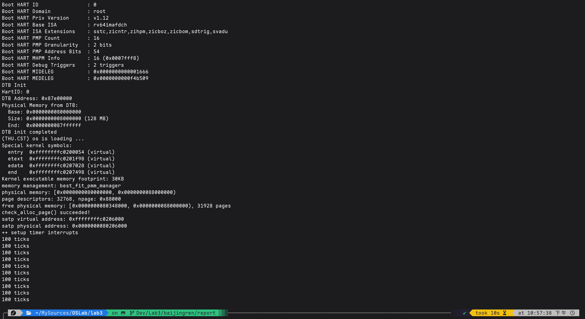
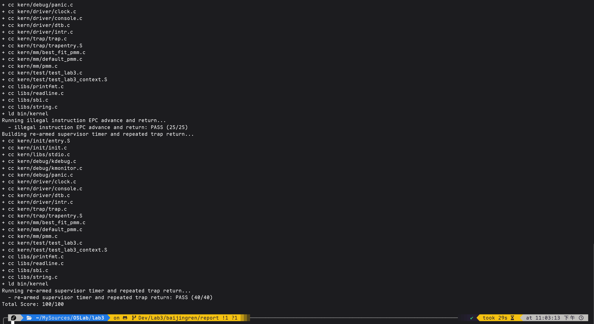

# 操作系统实验报告：Lab3 中断与异常

## 实验基本信息

| 项目 | 内容 |
|------|------|
| 实验名称 | Lab3：中断与异常 |
| 小组成员 | 2413597-白景仁、2412731-陈彦兴、2411783-何闻硕 |
| 完成日期 | 2026-11-03 |

### 小组分工

| 成员 | 负责的练习/模块 | 对应提交 |
|------|----------------|----------|
| 白景仁（`baijingren`） | 功能模块二中的异常处理、宿主机与 QEMU 异常测试、报告整合 | `33688b5` |
| 陈彦兴（`cyx`） | 功能模块二中的中断分类、时钟重设、计数输出与阈值关机 | `094ffa5`、`5b6c08c`、`57580c1` |
| 何闻硕（`hews`） | 功能模块一：Trap 入口与上下文恢复；Lab2 启动映射和物理内存依赖 | `8171bde`、`0954228`、`cbfe627`、`dc03100` |

白景仁负责报告正文整合；中断部分按中断分类、时钟计数、关机阈值分步提交，Trap 入口与异常处理合入后统一做端到端验证。Lab3 的 Lab2 依赖按功能片段回填，保留本章的中断保护包装，未重新引入 Buddy 或 SLUB。

---

## 一、实验目的

1. 理解 RISC-V 的 Trap 机制，区分同步异常与异步中断，掌握 `stvec`、`scause`、`sepc`、`sstatus`、`sscratch` 等 CSR 的作用。
2. 掌握 Trap 发生时保存通用寄存器和关键 CSR、进入 C 处理函数、恢复上下文并通过 `sret` 返回的完整流程。
3. 实现断点、非法指令及未知异常处理，特别是根据指令编码推进 `epc`，避免返回后反复触发同一异常。
4. 实现中断分类与时钟中断处理，理解一次性定时事件如何被重设为周期性时钟，并完成计数输出和关机。
5. 练习为 AI 编写带接口、边界条件和可执行验收标准的提示词，用独立测试和真实运行结果核对生成代码。

---

## 二、实验环境

### 系统工具

| 软件 | 版本 |
|------|----------------|
| riscv64-unknown-elf-gcc | 16.2.0 |
| qemu-system-riscv64 | 11.1.2 |
| 固件 | OpenSBI v1.8.1，QEMU `-bios default` |
| 宿主环境 | macOS，Make、Python 3、POSIX shell |

当前 QEMU 配合默认 OpenSBI 和 Makefile 的 `-device loader` 时，`Domain0 Next Address` 为 0，内核没有运行。运行和评分验证时在临时副本中改用 `-kernel bin/ucore.img`，没有改变内核源码或评分断言。原始命令的实测结果与这一区别见第五章。

### AI 工具

| 成员 | AI 编程工具 | 底层模型 |
|------|------------|---------|
| 2413597-白景仁 | Cursor | Gork4.7 |
| 2412731-陈彦兴 | Claude Code | DeepSeek Flash |
| 2411783-何闻硕 | Codex | GPT 6.1 Sol |

---

## 三、实验整体逻辑分析

### 3.1 本章节的逻辑主线

Lab3 要解决的问题是：CPU 被外部事件或异常指令打断后，内核怎样接管处理器，又怎样让原执行流不受影响地继续。

```text
OpenSBI 启动 S 态内核
  → idt_init：sscratch=0，stvec=__alltraps
  → 时钟初始化并开启中断 / 指令触发异常
  → CPU 保存 sepc、scause 等，跳到 __alltraps
  → SAVE_ALL：在当前内核栈上形成 36 个槽位的 Trap frame
  → move a0, sp；jal trap
  → trap_dispatch：按 cause 最高位区分中断与异常
       → interrupt_handler：重设时钟、计数、其他中断提示
       → exception_handler：打印原因、必要时修改 tf->epc
  → __trapret → RESTORE_ALL → sret
  → 回到原执行流；时钟中断则再次进入上述闭环
```

硬件只保存少量状态就跳转，寄存器现场得由内核代码自己存。`trapframe` 是汇编入口和 C 处理函数共用的约定：前 32 个槽位为通用寄存器，后 4 个槽位依次为 `sstatus`、`sepc`、`stval`（结构体字段名 `badvaddr`）和 `scause`。C 函数修改 `tf->epc` 后，汇编返回路径必须读取修改后的值，而不是重新使用硬件最初保存的 `sepc`。

### 3.2 功能的逐步实现

1. 先回填 Lab2 依赖。Lab3 还在 `pmm_init()` 里初始化物理内存，没有 `page_init()` 和 Best-Fit，完整内核根本构建不出来，也就没法用统一镜像验证 Trap。回填时把 Lab3 的 `local_intr_save/local_intr_restore` 留着，免得分配空闲链表时被中断打断。
2. 再补 Trap 入口和上下文恢复。所有中断和异常都要先走这条路。先把帧布局、`sp` 的特殊处理和 `sret` 需要的状态定清楚，后面处理函数出问题时，才不会和入口的错误混在一起。
3. 中断和异常拆开并行做。异常先写宿主机测试再实现；中断按“分类 → 时钟重设计数 → 阈值关机”三步走。两边共用入口，但逻辑和验收可以各自独立。
4. 最后做集成验证。在真实 RISC-V QEMU 上看寄存器恢复、断点和非法指令返回、持续时钟中断。前三步都对，这条 Trap 路径才算走通。

---

## 四、实验内容与实现

### 前置：Lab2 物理内存依赖回填

负责人：2411783-何闻硕

需要恢复的函数包括 `page_init()`、Best-Fit 的初始化、登记、分配、释放与计数，以及 `init_pmm_manager()` 的管理器选择。

`page_init()` 通过 DTB 获得内存范围，在内核 `end` 后按页对齐放置 `struct Page` 数组。先将全部描述符标为保留，再只开放内核和描述符数组之后的完整页，避免固件、内核和管理元数据被分配出去。

Best-Fit 沿用 Lab2 已验证的按地址有序空闲链表和最小足够块选择。迁移没有整文件覆盖：Lab3 的 `alloc_pages()`、`free_pages()` 和 `nr_free_pages()` 外层保留中断保护。启动映射还保留根页表索引 2 的 1 GiB 恒等映射和索引 511 的高地址映射，使写 `satp` 后低地址 PC 仍能取指，再显式跳转到高地址。

本模块提示词和迁移边界见 [prompt.md](prompt.md#一lab2-依赖回填)。最终启动输出确认 128 MiB 内存、32768 个页描述符、31928 个空闲页以及 `check_alloc_page() succeeded!`。

---

### 功能模块一：Trap 上下文恢复与 Trap 入口

负责人：2411783-何闻硕

#### 模块功能描述

需要实现的部分：

```asm
# lab3/kern/trap/trapentry.S
.macro RESTORE_ALL
__alltraps:
```

对外接口：

```c
void trap(struct trapframe *tf);
```

`SAVE_ALL` 先保存原始 `sp`，再将栈向下移动 `36 * REGBYTES`，依次保存通用寄存器和 Trap CSR。恢复必须与这个布局严格一致，不能假设 `sp` 和其他寄存器的保存方式相同。

实现采用以下顺序：

1. 用 `s0`、`s1`、`s2` 中转，恢复 `sstatus`、`sepc`、`stval`。
2. 恢复 `x1`、`x3`～`x31`。`x0` 硬连线为零，无需恢复；`scause` 只描述本次 Trap 原因，无需作为返回状态恢复。
3. 最后从槽位 2 恢复原始 `sp`。如果提前恢复 `sp`，后续 `LOAD` 就会以错误的地址为基址。
4. `__alltraps` 在 `SAVE_ALL` 后执行 `move a0, sp` 和 `jal trap`。返回后自然落入 `__trapret`，再执行 `RESTORE_ALL` 与 `sret`。

```asm
__alltraps:
    SAVE_ALL
    move a0, sp
    jal trap

__trapret:
    RESTORE_ALL
    sret
```

汇编入口不在 `epc` 上加固定值。中断直接回到被打断的位置；异常则在处理函数里按指令长度改帧里的 `epc`，两类情况共用同一条返回路径。

#### 最终提示词

提示词把 36 个槽位、`sp` 的特殊含义、CSR 中转顺序、`a0` 传参和 `sret` 验收写成明确约束，完整整理见 [prompt.md](prompt.md#二trap-上下文恢复与-trap-入口何闻硕)。

#### 实现迭代过程

第一次迭代先只做编译。补上两个练习位置，没拿临时处理函数绕开完整的 Trap 闭环。这一步只能确认汇编语法和静态覆盖，运行时恢复对不对，得等集成以后才看得出来。

第二次迭代处理工具链兼容。新工具链不认旧的 CSR 名 `sbadaddr`，照着当前特权架构里同名的 CSR 改成 `stval`，只改了两处名字，帧布局和行为都没动。报告里写的是最终合入的版本。

第三次迭代做集成和启动修正。异常处理和中断分支合入后，我们用真实的断点探针看了入口指针、全部通用寄存器、`sscratch`、`scause`、`sstatus.SPP` 和下一条指令的执行情况。第一次直接跑本机 `make qemu` 时没有任何内核输出，固件显示下一阶段地址是 0，换成 `-kernel` 才进到内核。问题出在启动参数上，不在 `RESTORE_ALL` 的寄存器恢复。

最终结果：

- 汇编与完整内核构建通过。
- QEMU 异常探针的 72 项检查全部通过，包括 32 个寄存器的保存值和返回值。
- 官方评分中的 Trap 入口、寄存器恢复和断点 EPC 用例通过。

---

### 功能模块二：异常处理

负责人：2413597-白景仁

#### 模块功能描述

需要实现的函数：

```c
void exception_handler(struct trapframe *tf);
static uintptr_t exception_instruction_length(uintptr_t epc);
```

`trap_dispatch()` 已在 `cause` 最高位为 0 时调用本函数，因此这里只按同步异常原因分派：

| `tf->cause` | 处理行为 |
|-------------|----------|
| `CAUSE_ILLEGAL_INSTRUCTION`（2） | 输出 `Illegal instruction at <原始 epc>`，按指令长度推进 `epc` |
| `CAUSE_BREAKPOINT`（3） | 输出 `Breakpoint at <原始 epc>`，按指令长度推进 `epc` |
| 其他异常 | 输出完整 Trap frame；来自内核时 `panic`，来自用户态时返回，不修改 `epc` |

当前编译器默认支持压缩指令，不能一律加 4。实现只在这两个已识别分支读取 `epc` 指向的第一个 16 位半字：

```c
parcel = *(uint16_t *)epc;
return (parcel & 0x3) == 0x3 ? 4 : 2;
```

本实验处理的是 16/32 位指令，首半字低两位不是 `0b11` 即为 16 位编码。这里没有扩展 48/64 位指令判断。打印地址使用 `%016llx`，避免宿主机地址高于 4 GiB 时被 `%08x` 截断。未知异常不能解引用 `epc`，否则 `epc=0` 或不可读页会造成二次故障。

#### 最终提示词

实现和测试分为两份提示词。测试先规定断点、非法指令、压缩编码、未知异常、字段不变量和对抗变体；实现提示词限制只能改异常处理及入口调用缺口，并要求通过统一脚本验收。完整整理见 [prompt.md](prompt.md#三异常处理与测试白景仁)。

#### 实现迭代过程

第一次迭代把泛化的需求写成可执行规格。初稿只说“处理断点和非法指令”，压缩指令、未知异常要不要 panic、地址宽度、怎么测，都没写清楚。补充之后，每个 `cause` 打印什么、`epc` 怎么变、字段不变量、用户态和内核态的区别，都落成了断言。

第二次迭代管测试规模和错误用例。测试一度写到约 1100 行，里面有一整层没编译过的 QEMU 测试，还有手写的解析。后来把测试收回到宿主机，直接编译真实的 `trap.c`，QEMU 层只验入口和恢复，对抗变体放到临时目录。另外，被当成非法指令的 16 位编码 `0x0001` 其实是合法的 `c.nop`，测试向量不能只看 AI 给的名字，得对着手册和反汇编核。

第三次迭代把异常和恢复集成起来。合入后原宿主机脚本链接时报缺 `clock_set_next_event`、`ticks`、`sbi_shutdown`，这几个符号是新加的中断代码引入的，说明脚本原本只覆盖中断还没实现时的独立异常分支。我们没有为报告去改测试或加桩，而是用完整内核跑同一份 QEMU 探针，再用原评分里的异常用例复验。这个脚本要重新当一键回归用，还得把缺的链接桩补上。

最终结果：

- 断点和非法指令均打印原始完整地址，16/32 位分别推进 2/4 字节。
- 未知异常打印 Trap frame，并根据 `sstatus.SPP` 选择返回或 `panic`。
- 原评分中的断点返回用例和非法指令返回用例均通过。

---

### 功能模块二：中断处理

负责人：2412731-陈彦兴

#### 模块功能描述

需要实现的函数与常量：

```c
#define TICK_NUM 100
#define SHUTDOWN_AFTER 10
void interrupt_handler(struct trapframe *tf);
```

`scause` 的最高位标识中断，`IRQ_S_*` 常量本身不包含这一位，因此先清除最高位再比较原因号。RV64 下清除的是第 63 位。

各分支如下：

| 中断类型 | 处理行为 |
|----------|----------|
| `IRQ_S_TIMER` | `clock_set_next_event()` 重设定时器，`ticks++`；每 100 次输出一次；累计输出 10 次后调用 `sbi_shutdown()` |
| `IRQ_S_SOFT` | 输出 `Supervisor software interrupt` |
| `IRQ_S_EXT` | 输出 `Supervisor external interrupt` |
| 未知中断 | 输出原因号，并调用 `print_trapframe(tf)` |

时钟这里得先重设下一次事件，再计数。`sbi_set_timer()` 设置的是一次性事件，光把 `ticks` 加一，系统只会收到一次时钟中断。`clock_set_next_event()` 以当前 `rdtime` 加 `timebase=100000` 设置下一事件；QEMU 时钟是 10 MHz，标称间隔 10 ms。实现是按当前时刻重设的，输出或处理耗时会拉长实际周期，没有做固定绝对周期的漂移补偿。

`SHUTDOWN_AFTER=10` 表示累计 10 次 `100 ticks` 输出后关机，即约 1000 个 tick。计数条件用 `ticks % TICK_NUM == 0`，关机判断用 `ticks / TICK_NUM >= SHUTDOWN_AFTER`，统计的是累计输出次数，而不是单次处理内的局部计数。

#### 最终提示词

原始任务分四次提交完成，这里把等价的接口和行为约束汇总成一份提示词，见 [prompt.md](prompt.md#四中断处理陈彦兴)；分步过程留在对应的 change 记录里。

#### 实现迭代过程

第一次迭代先做中断分类：提取原因号，处理软件中断、外部中断和未知中断的输出，单独编译 `trap.o`。这时时钟还没做完，一次定时器事件说明不了持续中断是否正常。

第二次迭代补时钟重设和计数，加上 `clock_set_next_event()`、`ticks++` 和 `print_ticks()`。在临时集成副本里跑原 Test 3，能看到 `100 ticks`、`ticks=200` 和持续时钟的通过信息。

第三次迭代加关机，再做整体复验。引入 `SHUTDOWN_AFTER`，第十次周期输出后调 `sbi_shutdown()`。所有分支合入后再跑一遍，连续输出 10 行 `100 ticks`，进程以退出码 0 结束。原评分的三个用例，是在改过 QEMU 启动参数的临时副本里全部通过的。

---

### Challenge

本章指导书未布置需要单独实现的 Challenge，本次没有额外扩展用户态 Trap、优先级调度或嵌套中断功能。

---

## 五、测试与验证

### 5.1 构建与启动运行

在当前报告分支的实验代码上执行干净构建：

```bash
make -C lab3 clean
make -C lab3
make -C lab3 qemu QEMU="qemu-system-riscv64 -kernel bin/ucore.img"
```

构建成功，最终生成 `lab3/bin/kernel` 和 `lab3/bin/ucore.img`。QEMU 实际输出确认：

- DTB 报告 `[0x80000000, 0x88000000)` 的 128 MiB 物理内存。
- Best-Fit 自检成功，空闲页为 31928 页。
- 连续输出 10 行 `100 ticks`，随后进程退出码为 0，证明持续时钟、重复 Trap 返回和关机路径都已执行。



图中省去了固件平台列表，其余数值和十次时钟输出都是原始结果。

### 5.2 Trap 上下文专项验证

将现有 `test/exception/qemu_exception.c` 和 `qemu_exception.S` 与真实完整内核链接，通过 `--wrap=trap` 记录进入 C 处理函数时的帧地址、CSR 和 36 个槽位，再用 `-kernel` 启动。实际结果共 72 项通过、0 项失败：

| 检查类别 | 实测结果 |
|----------|----------|
| 参数与入口状态 | `tf` 等于进入时 `sp`；进入时 `sscratch=0`、`scause=3`、`sstatus.SPP=1` |
| 返回状态 | 能执行断点后的下一条指令；`sp` 恢复；`sscratch` 符合约定 |
| 通用寄存器 | 返回后的 `x0`～`x31` 共 32 项通过；进入帧中的 `tf-x0`～`tf-x31` 共 32 项通过 |
| 帧中的原因与模式 | `tf-cause`、`tf-spp` 通过 |


图中把连续的寄存器通过项合并了几行，其余按原始输出列出。

### 5.3 原始评分测试

原评分包含三个独立构建和运行用例：

| 用例 | 分值 | 本次结果 |
|------|------|----------|
| Trap 入口、寄存器恢复、断点 EPC | 35 | PASS（35/35） |
| 非法指令 EPC 推进与返回 | 25 | PASS（25/25） |
| 重设监督态时钟与重复 Trap 返回 | 40 | PASS（40/40） |
| 合计 | 100 | 100/100 |



本机先执行未修改的 `make -C lab3 grade`，三个用例均为 0 分。检查脚本和固件输出后确认：脚本使用 `-device loader,file=bin/ucore.img,addr=0x80200000`，当前 OpenSBI 的 `Domain0 Next Address` 为 0，因此测试没有进入内核。

随后在 `/tmp` 的临时副本里用同一份 `inject.py` 和同一组评分断言，只把 QEMU 启动参数换成 `-kernel bin/ucore.img`，三个用例就全部通过了，总分 100/100。临时脚本没有写进仓库；这个结果说明的是，同一份内核和同一组断言在能进内核的启动方式下可以跑通，不等于原始 `make grade` 原样通过。

### 5.4 其他测试与当前限制

- 分支开发阶段，中断 Test 3 曾在临时集成副本中通过；异常宿主机测试曾对多种错误实现做对抗检查，覆盖不推进 `epc`、固定加 2/4、交换异常、错误 panic 和修改其他字段。
- 本次重跑 `bash lab3/test/exception.sh` 时，宿主机链接缺了新增中断代码用到的 `clock_set_next_event`、`ticks`、`sbi_shutdown`，脚本没跑起来。完整内核里的 72 项检查和原评分异常用例是另外跑的，已经通过。
- 本次只在一个 hart 上跑过，多核并发、中断嵌套、用户态栈切换和中断优先级管理都没有验证，当前实现也不涉及这些。

---

## 六、实验总结与收获

### 对操作系统的理解

1. Trap 与程序控制流。原理课一般把中断/异常讲成“暂停当前程序，执行处理程序，再返回”。实验里这个过程拆开了：硬件写入 `sepc/scause` 并跳到 `stvec`，软件保存通用寄存器、处理原因、恢复现场。返回也不只是一条跳转，还得把 `sstatus` 和特权级状态恢复回去。
2. 同步异常与异步中断。二者共用入口和帧布局，靠 `scause` 最高位区分类型。异步时钟一般返回原 `epc`；断点、非法指令这类同步异常要跳过故障指令，就得有选择地推进 `epc`。统一返回路径不能固定加 4，原因就在这里。
3. 上下文与 ABI。原理课里的“进程上下文”比较抽象，实验里就是 36 个机器字和它们的保存、恢复顺序。`a0` 传参、`s0`～`s2` 中转、最后才恢复 `sp`，都说明上下文切换不是列一张寄存器清单就行，顺序错了照样出问题。
4. 内核态/用户态与特权级。`sstatus.SPP` 记着 Trap 前的特权级，`sret` 按它恢复执行环境。本实验基本都在内核态跑，用 `SPP` 判断未知异常该返回还是 `panic`；完整的用户态 Trap 和栈切换留到后面的实验。
5. 时钟与操作系统服务。周期性时钟不是硬件自动反复调用同一个 C 函数，得在每次处理完再编下一次事件。后面的时间片调度、延时和统计都靠它；这次只做了计数和关机，还没拿 tick 去做调度。
6. 原子性与共享内核状态。原理课反复讲临界区，本章 `alloc_pages/free_pages` 的中断保护就是个现成例子。Trap 随时可能打断内核，原先觉得“顺序执行不会冲突”的共享链表，开了中断之后就得重新看一遍。

原理课中重要、但本实验尚未充分对应的知识包括：用户进程及系统调用、基于时钟的抢占式调度、多核同步与死锁、完整中断控制器和优先级管理、缺页异常与按需分页、设备驱动的真实 I/O 完成中断，以及用户态与内核态之间的安全指针检查。本章验证了 Trap 基础设施，不等于这些上层机制已经实现。

### AI 协作开发的经验

- 先让 AI 审 Prompt，比直接让它写代码有用。审的时候发现“未知异常不能 panic”和“内核态要 panic”自相矛盾，用 `trap_in_kernel(tf)` 把两种情况分开，两条要求才同时成立。
- 验收标准要写得比需求细。和 Lab2 比，长 Prompt 的优势不在篇幅，而在有没有能跑的断言；Lab3 初稿缺这一项，AI 只能自己猜。
- 范围和规模得写死。有次测试产出约 1100 行，手写了本可以用标准库完成的解析，还写了一整层没编译过的 QEMU 测试。给个行数上限，再写明“不自己实现标准库功能”，会好很多。
- AI 给的测试数据要人工对着手册核。被标成“非法指令”的 2 字节编码 `0x0001` 其实是合法的 `c.nop`，不核对的话测试照样“通过”，但没什么意义。
- 规范上的结论以手册为准。`sepc` 的语义、压缩指令怎么判长度、`medeleg` 在 S 态读不到，这些 AI 说了之后，我们都对着手册确认过。
- 测试环境和内核实现要分开看。QEMU 启动参数不对，会出现“编译全过、运行全 0 分”的假象；先看固件交接地址和串口输出，别急着让 AI 改 Trap 代码。

这次实验最大的收获是：Trap 对不对，不能靠一个输出判断。保存、分派、原因处理、`epc` 更新、恢复，哪一环出错都可能表现成重复异常、只收到一次时钟，或者干脆起不来。把每一环都写成能观察的断言，再放到真实 QEMU 上跑一遍，比读一份看起来没问题的生成代码靠谱得多。
